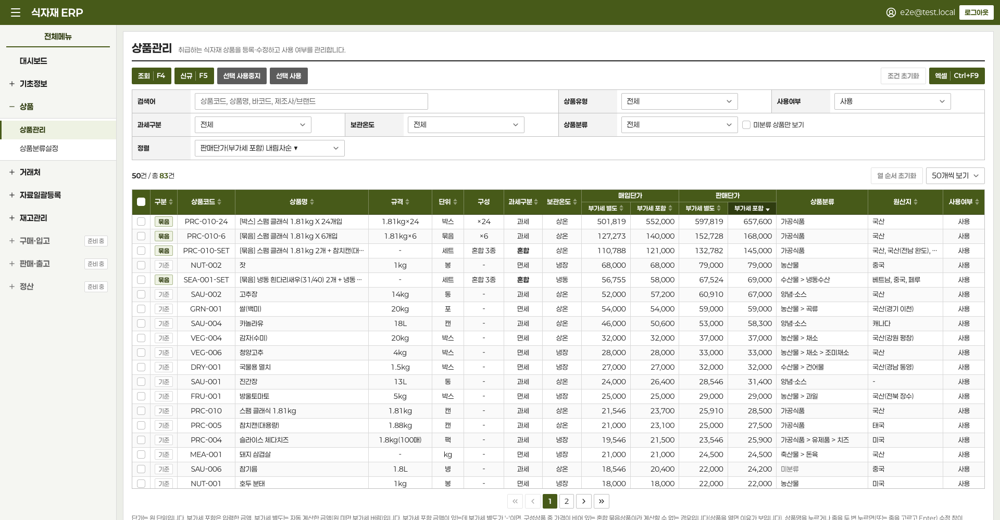
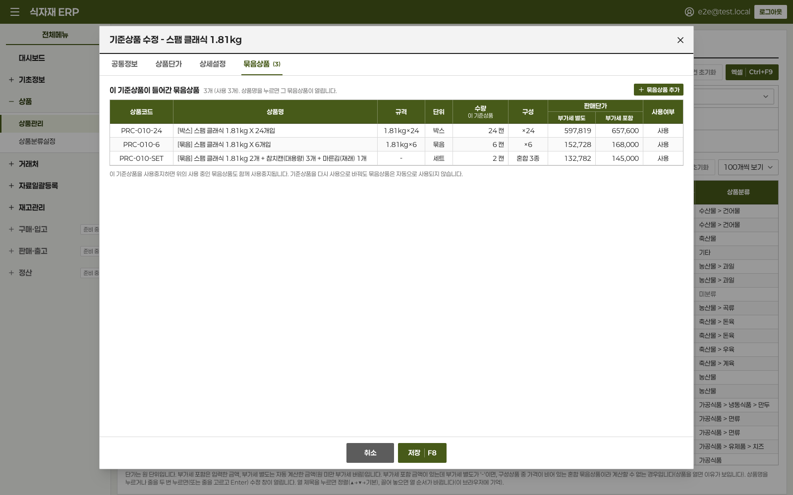
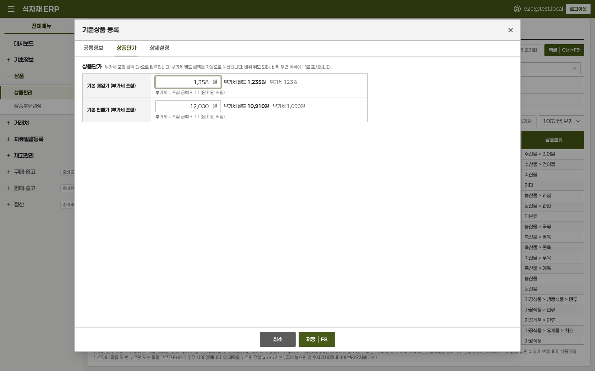
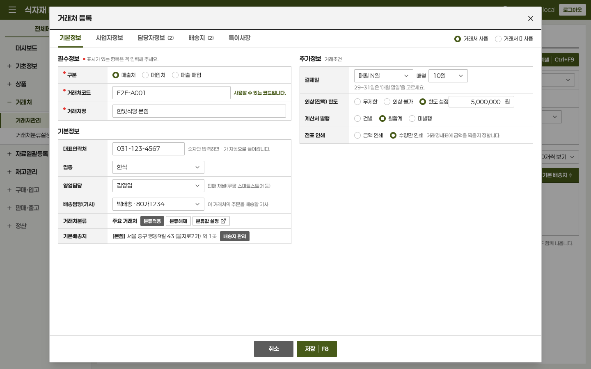
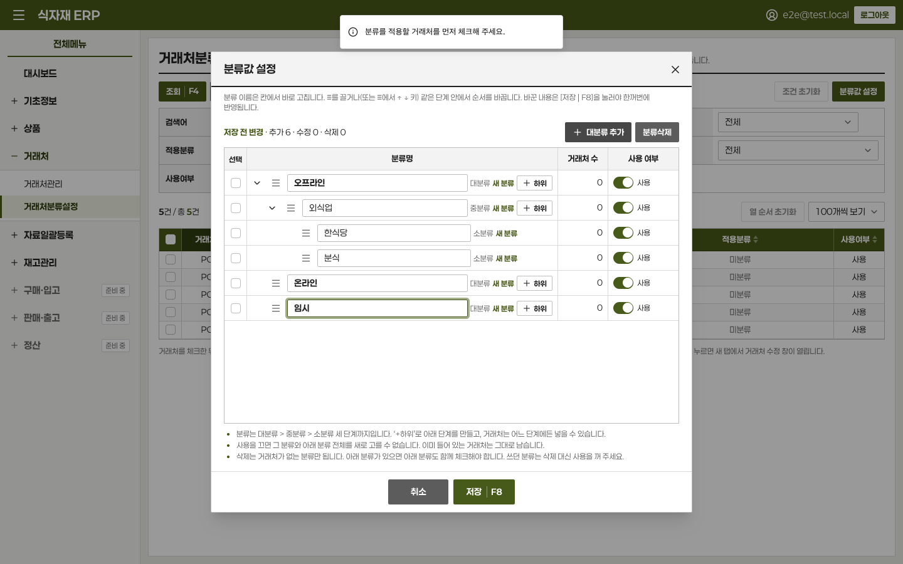
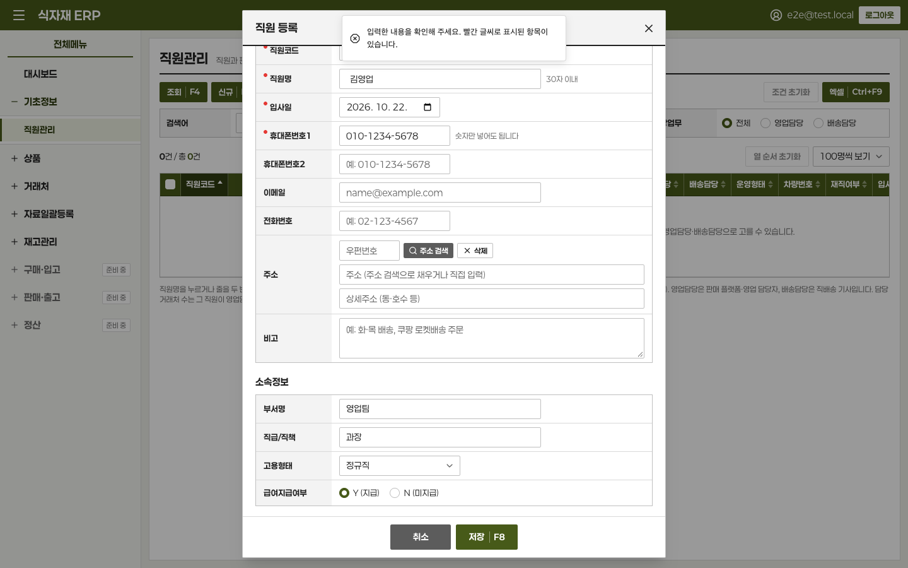
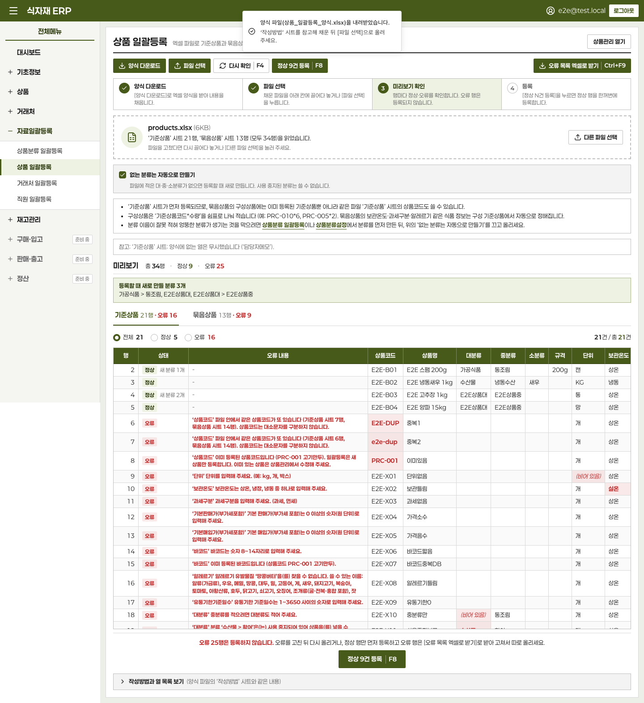

# 식자재 사내 ERP (Onkookmin ERP)

식자재 유통 회사 한 곳을 위한 사내 업무 프로그램(ERP)입니다. 인터넷 브라우저에서 열어 쓰는 웹 프로그램이고, 데이터와 로그인은 **Supabase**(Postgres 데이터베이스 + 로그인 서비스)에 저장됩니다. 취급하는 상품은 모두 식품이라, 보관온도·과세/면세·원산지·알레르기·유통기한 같은 식품 정보를 기본으로 다룹니다.



- 직원은 이메일과 비밀번호로 로그인합니다. **회원가입 화면은 없습니다.** 관리자가 Supabase 대시보드에서 직원 계정을 직접 만들어 줍니다.
- 화면은 도매 ERP에서 흔히 쓰는 모양(위쪽 색 막대, 왼쪽 메뉴, 기능키 버튼 줄, 검색 칸, 촘촘한 표, 큰 입력 창)입니다. 회사 색 **#475a19**(올리브 초록)과 글꼴 **페이퍼로지(Paperlogy)** 를 씁니다. 페이퍼로지는 상업적으로도 무료로 쓸 수 있는 글꼴입니다(라이선스: `src/app/fonts/OFL.txt`).

## 지금까지 만든 기능

| 메뉴         | 화면                                         | 할 수 있는 일                                                                                                                                                                                                                  |
| ------------ | -------------------------------------------- | ------------------------------------------------------------------------------------------------------------------------------------------------------------------------------------------------------------------------------ |
| 기초정보     | **직원관리**                                 | 직원 등록·수정, 재직/퇴사. 담당업무 **영업담당**(판매 플랫폼: 쿠팡·스마트스토어 등)과 **배송담당**(직배송 기사). 직원코드 자동 제안, 소속정보(부서·직급·고용형태·급여지급), 배송기사 정보(직영/지입/용차, 차량번호, 차량 종류) |
| 상품         | **상품관리**                                 | **기준상품(개입)** 과 **묶음상품**(같은 상품 N개 묶음, 박스, 여러 상품이 섞인 세트) 등록·수정. 묶음상품의 식품 정보는 구성품에서 자동 계산. 단가는 **부가세 포함**으로 입력하고 부가세 별도 금액을 함께 표시                   |
| 상품         | **상품분류설정**                             | 대분류 > 중분류 > 소분류 3단계 분류 관리 (분류 없으면 미분류)                                                                                                                                                                  |
| 거래처       | **거래처관리**                               | 매출처·매입처 등록·수정. 사업자정보(사업자등록번호 자동 검증), 거래처 담당자, 배송지(우편번호 검색), 거래조건(결제일·외상한도·계산서 발행·전표 인쇄), 영업담당·배송기사 지정                                                   |
| 거래처       | **거래처분류설정**                           | 3단계 분류 트리 관리(끌어서 순서 바꾸기, 한 번에 저장) + 여러 거래처에 분류를 한꺼번에 적용·해제                                                                                                                               |
| 자료일괄등록 | **상품분류 / 상품 / 거래처 / 직원 일괄등록** | 엑셀 양식 내려받기 → 채운 파일(.xlsx·.csv) 올리기 → 미리보기에서 오류 확인 → 한 번에 등록 (전부 저장되거나, 하나도 저장되지 않음)                                                                                              |
| 자료일괄등록 | **기초재고 일괄등록**                        | 재고관리를 시작할 때 지금 창고에 있는 재고(로트·기한·위치·단가)를 엑셀 파일로 한 번에 넣기 (오늘 날짜의 기초재고 전표 하나)                                                                                                    |
| 재고관리     | **상품별 재고현황**                          | 기간별 이월·입고·출고·조정·폐기·기말 재고, 재고단가와 재고금액(부가세 포함·별도), 가장 빠른 기한(D-day). 상품을 누르면 상품별 거래수불                                                                                         |
| 재고관리     | **재고처별 재고현황**                        | 창고 > 구역 > 선반별·로트(기한)별 재고. 기한 임박(노랑)·기한 경과(빨강), 보관온도 불일치 표시. 체크한 재고를 바로 이동·폐기                                                                                                    |
| 재고관리     | **상품별 거래수불**                          | 한 상품의 기간 내 입고·출고를 전표마다, 이월부터 잔량과 함께                                                                                                                                                                   |
| 재고관리     | **입고 / 출고 / 폐기 / 재고처간 이동 등록**  | 전표로 재고를 넣고 뺍니다. 출고는 **기한이 빠른 로트부터 자동 배정**(FEFO), 묶음상품은 구성 기준상품 수량으로 나눠 계산. 잘못 넣은 전표는 취소 전표로 되돌림                                                                   |
| 재고관리     | **실사재고조정**                             | 창고·구역·선반의 전산 재고를 불러와 직접 센 수량을 입력하면 **차이만큼만** 조정. 창고에서 찾은 재고는 새 로트로                                                                                                                |
| 재고관리     | **창고·로케이션 설정**                       | 창고 > 구역(상온·냉장·냉동) > 선반 관리, 기한 임박 기준일(처음엔 7일)                                                                                                                                                          |
| 대시보드     | **재고 알림**                                | 기한 경과·기한 임박·보관온도 불일치 재고와 최근 전표. 누르면 해당 재고 화면으로                                                                                                                                                |
| 준비 중      | 구매·입고, 판매·출고, 정산                   | 메뉴 자리만 있습니다                                                                                                                                                                                                           |

재고관리는 DB 변경 8번을 씁니다(실제 DB 반영 완료). 시작 순서는 [재고관리 사용법](#재고관리-사용법)에 있습니다.

모든 목록 화면 공통: **기능키**(F4 조회, F5 신규, F8 저장, Esc 닫기, Ctrl+F9 엑셀), 등록·수정은 목록 위에 뜨는 큰 창, 검색·필터, **열 제목을 끌어서 순서 바꾸기**, **열 제목을 눌러 정렬**, 체크한 행 한꺼번에 사용중지/사용, **엑셀(CSV) 내려받기**. 데이터는 지우지 않고 사용중지(퇴사·미사용)로 관리합니다.

## 화면 미리보기

| 묶음상품 (기준상품 수정 창의 묶음상품 탭)            | 단가 입력 (부가세 포함 → 별도 자동 계산)                  |
| ---------------------------------------------------- | --------------------------------------------------------- |
|  |         |
| **거래처 등록 창**                                   | **거래처분류 — 분류값 설정**                              |
|     |    |
| **직원 등록 창**                                     | **자료일괄등록 — 미리보기**                               |
|      |  |

(사진의 데이터는 모두 시험용 가짜 데이터입니다.)

## 사용 기술

- **화면·서버**: Next.js 16 (App Router, Server Actions), React 19, TypeScript
- **디자인**: Tailwind CSS v4, shadcn/ui (Base UI), 페이퍼로지 글꼴
- **데이터베이스·로그인**: Supabase (Postgres 17, Auth, 행 단위 보안 RLS). 여러 표를 한 번에 저장하는 일은 DB 함수 하나로 처리해 반쯤 저장되는 일이 없게 했습니다.
- **입력 검사**: zod, react-hook-form
- **엑셀**: read-excel-file, write-excel-file (내려받기는 한글이 깨지지 않는 CSV)

## DB 변경 기록 (supabase/migrations)

| 순서 | 파일                                                         | 내용                                                    |
| ---- | ------------------------------------------------------------ | ------------------------------------------------------- |
| 1    | `20261021022829_create_products.sql`                         | 상품, 상품분류                                          |
| 2    | `20261021055933_products_optional_category_box_quantity.sql` | 분류 선택 사항(미분류)                                  |
| 3    | `20261021090954_bundle_products.sql`                         | 기준상품/묶음상품, 구성표, 묶음상품 식품 정보 자동 계산 |
| 4    | `20261022014503_vat_inclusive_prices.sql`                    | 단가를 부가세 포함으로 저장, 부가세 계산 함수           |
| 5    | `20261022062448_partners.sql`                                | 거래처, 거래처 담당자·배송지, 거래처분류, 직원          |
| 6    | `20261022083130_partner_categories_tree_employees_v2.sql`    | 거래처분류 3단계, 직원 담당업무·소속·배송기사 정보      |
| 7    | `20261022101634_bulk_import.sql`                             | 자료일괄등록용 DB 함수                                  |
| 8    | `20261023015348_inventory.sql`                               | 재고관리 전체                                           |

8번은 창고·구역·선반, 로트, 재고 전표(기초재고·입고·출고·폐기·이동·실사조정·취소), 현재 재고, 기한 임박 설정, 출고 배정(FEFO), 재고 보고서, 기초재고 일괄등록 함수를 새로 만듭니다. 이미 있는 상품·거래처·직원 자료는 바꾸지 않습니다. 상품 표에는 규칙 하나만 더합니다: **재고 기록이 있는 상품은 단위를 바꿀 수 없습니다**(재고 수량이 그 단위로 기록되어 있기 때문).

## 사용 설명서 목차

- [처음 한 번만 하는 설정](#처음-한-번만-하는-설정)
- [상품관리 사용법](#상품관리-사용법)
- [직원관리 사용법](#직원관리-사용법)
- [거래처관리 사용법](#거래처관리-사용법)
- [자료일괄등록 사용법](#자료일괄등록-사용법)
- [재고관리 사용법](#재고관리-사용법) (기초재고 일괄등록, 실사재고조정 포함)
- [자주 쓰는 명령어](#자주-쓰는-명령어) · [폴더 구조](#폴더-구조) · [나중에 할 일](#나중에-할-일)

개발 규칙(코드 작성 방식, DB 규칙, 화면 규칙)은 [CLAUDE.md](CLAUDE.md)에 정리돼 있습니다.

## 준비물

1. **Node.js 22 이상** — 이 프로그램을 내 컴퓨터에서 실행하는 데 필요합니다.
   - https://nodejs.org 에서 **LTS** 버전을 내려받아 설치하세요.
   - 설치 확인: 터미널에서 아래를 입력했을 때 `v22.` 이상 숫자가 나오면 됩니다.
     ```bash
     node -v
     ```
2. **Supabase 계정** — https://supabase.com 에서 가입합니다. (무료로 시작할 수 있습니다)

> 터미널은 macOS의 "터미널" 앱(Spotlight에서 "터미널" 검색)을 쓰면 됩니다. 아래 회색 상자 안의 명령어를 복사해서 붙여 넣고 Enter를 누르세요.

## 처음 한 번만 하는 설정

### 1단계. Supabase 프로젝트 만들기

1. https://supabase.com/dashboard 에 로그인합니다.
2. **New project**를 누릅니다.
3. 아래처럼 입력합니다.
   - **Project name**: `food-erp` (다른 이름이어도 괜찮습니다)
   - **Database Password**: 어려운 비밀번호를 정하고, **안전한 곳에 꼭 적어 두세요.** (나중에 DB를 바꿀 때 필요합니다)
   - **Region**: `Northeast Asia (Seoul)`
4. **Create new project**를 누르고 1~2분 기다립니다.

### 2단계. 연결 정보 넣기 (.env.local)

1. 터미널에서 프로젝트 폴더로 이동한 뒤, 견본 파일을 복사해 `.env.local` 파일을 만듭니다.
   ```bash
   cd ~/Documents/사내_ERP
   cp .env.example .env.local
   ```
2. `.env.local` 파일을 텍스트 편집기로 엽니다.
   ```bash
   open -e .env.local
   ```
3. Supabase 대시보드에서 두 값을 복사해 `=` 뒤에 붙여 넣고 저장합니다.

   | 넣을 곳                                | 찾는 곳 (Supabase 대시보드)                                                                      |
   | -------------------------------------- | ------------------------------------------------------------------------------------------------ |
   | `NEXT_PUBLIC_SUPABASE_URL`             | **Project Settings**(왼쪽 아래 톱니바퀴) → **Data API** → **Project URL**                        |
   | `NEXT_PUBLIC_SUPABASE_PUBLISHABLE_KEY` | **Project Settings** → **API Keys** → **Publishable key** (`sb_publishable_`로 시작하는 긴 글자) |

   다 넣으면 이런 모양이 됩니다. (값은 예시입니다)

   ```
   NEXT_PUBLIC_SUPABASE_URL=https://abcdefghijklmnopqrst.supabase.co
   NEXT_PUBLIC_SUPABASE_PUBLISHABLE_KEY=sb_publishable_xxxxxxxxxxxxxxxx
   ```

> **주의**: 같은 화면에 있는 **Secret key**(`sb_secret_`로 시작)나 `service_role` 키는 절대 넣지 마세요. 이 키가 새어 나가면 누구나 모든 데이터를 볼 수 있습니다.
>
> `.env.local` 파일은 git(코드 저장소)에 올라가지 않으니, 컴퓨터를 바꾸면 이 단계를 다시 해야 합니다.

### 3단계. 아무나 가입하지 못하게 막기

Supabase 대시보드에서 **Authentication** → **Sign In / Providers** → **Allow new users to sign up**을 **끄고** 저장(**Save changes**)합니다.

> 왜 필요한가요? 프로젝트 안의 `supabase/config.toml`에도 "가입 막기"를 설정해 두었지만, 그 파일은 내 컴퓨터에서 Supabase를 따로 돌릴 때만 쓰입니다. 실제 Supabase 프로젝트에는 대시보드에서 직접 꺼야 적용됩니다.

### 4단계. 첫 직원 계정 만들기

1. Supabase 대시보드에서 **Authentication** → **Users** → **Add user** → **Create new user**를 누릅니다.
2. 이메일과 비밀번호를 입력하고, **Auto Confirm User**를 체크한 뒤 **Create user**를 누릅니다.
3. 직원이 늘어나면 같은 방법으로 계정을 추가하고, 비밀번호는 직원에게 안전하게 전달하세요.

### 5단계. 설치하고 실행하기

다른 컴퓨터에서 처음 받는 경우에는 먼저 GitHub에서 코드를 내려받습니다.

```bash
git clone https://github.com/HanSeongJun/Onkookmin_ERP.git ~/Documents/사내_ERP
```

프로젝트 폴더로 이동한 뒤 아래 명령어를 차례로 실행합니다. (`npm install`은 처음 한 번, 또는 프로그램 구성이 바뀌었을 때만 하면 됩니다)

```bash
cd ~/Documents/사내_ERP
npm install
npm run dev
```

브라우저에서 http://localhost:3000 을 열고, 4단계에서 만든 계정으로 로그인하면 됩니다.

> 3000번을 이 컴퓨터의 다른 프로그램이 이미 쓰고 있다면 `npm run dev -- -p 3001`로 켜고 http://localhost:3001 을 엽니다.

끌 때는 터미널에서 `Ctrl` + `C`를 누릅니다.

## 상품관리 사용법

> **처음 한 번 (DB 반영):** 상품관리는 DB 테이블(상품, 상품 분류, 묶음상품 구성표)을 씁니다. 새 DB 변경 파일이 생기면 실제 Supabase DB에도 반영해야 화면이 제대로 열립니다. 아래 "DB(테이블) 바꾸기"의 `npm run db:push`를 실행하세요. (실제 회사 DB를 바꾸는 일이니, 무엇이 바뀌는지 확인한 뒤 실행합니다.)
>
> - 2026년 10월 21일 **기준상품/묶음상품** 변경: **박스입수량** 칸과 그 값은 DB에서 없어집니다. 박스는 이제 묶음상품으로 등록합니다.
> - 2026년 10월 22일 **단가 부가세 포함** 변경: 반영하기 전에는 상품관리 화면이 오류를 냅니다. 반영해도 **이미 넣어 둔 단가는 바뀌지 않습니다.** 원래 부가세 포함 금액으로 넣어 두셨기 때문에 금액은 그대로 두고, 부가세 별도 금액과 부가세만 자동으로 계산해 옆에 보여 줍니다([8. 단가와 부가세](#8-단가와-부가세) 참고). 반영한 뒤 상품 몇 개를 열어 단가가 그대로인지 확인해 보세요.

### 화면 둘러보기

- **위쪽 초록 막대**: 왼쪽 ☰ 버튼으로 메뉴를 열고 닫습니다(`Ctrl` + `B`도 됩니다). 오른쪽에 로그인한 이메일과 **로그아웃** 버튼이 있습니다.
- **왼쪽 메뉴(전체메뉴)**: `+`를 누르면 묶음이 펼쳐지고 `−`를 누르면 접힙니다. 지금 보고 있는 화면은 색이 칠해져 있습니다.
  - **기초정보** → **직원관리**(직원 명단. 거래처의 영업담당·배송담당을 여기서 고릅니다)
  - **상품** → **상품관리**(상품 목록, 등록·수정), **상품분류설정**(분류 만들기)
  - **거래처** → **거래처관리**(매출처·매입처 목록, 등록·수정), **거래처분류설정**(거래처를 분류에 넣기, **분류값 설정**에서 대·중·소분류 만들기)
  - **자료일괄등록** → **상품분류 일괄등록**, **상품 일괄등록**, **거래처 일괄등록**, **직원 일괄등록**, **기초재고 일괄등록**(엑셀 파일로 여러 건을 한 번에 등록)
  - **재고관리** → **상품별 재고현황**, **재고처별 재고현황**, **상품별 거래수불**, **입고 등록**, **출고 등록**, **폐기 등록**, **재고처간 이동등록**, **실사재고조정**, **창고·로케이션 설정**
  - 아직 누를 수 없는 구매·입고, 판매·출고, 정산
- **목록 화면**은 위에서부터 이렇게 생겼습니다: 화면 이름 → 버튼 줄(조회, 신규, 선택 사용중지, 선택 사용, 오른쪽 끝에 엑셀) → 검색 칸 → "22건 / 총 5,944건" 같은 건수 → 표.
- **등록·수정**은 목록 위에 뜨는 큰 창에서 합니다. 창 위쪽에 탭이 있고, 빨간 점(•)이 붙은 칸은 꼭 채워야 합니다. 아래쪽 가운데에 [취소] [저장 | F8] 버튼이 있습니다.

### 단축키

버튼 이름 옆의 `| F4` 같은 글자가 그 버튼의 단축키입니다.

| 키            | 하는 일                                                                      | 쓰는 곳                                                                                                          |
| ------------- | ---------------------------------------------------------------------------- | ---------------------------------------------------------------------------------------------------------------- |
| `F4`          | 조회 (검색 칸의 조건으로 목록 다시 보기)                                     | 상품관리·거래처관리·직원관리 목록, 거래처분류설정, 재고관리 화면                                                 |
| `F5`          | 신규 (등록 창 열기). 이 화면들에서는 브라우저 새로고침 대신 이 기능이 됩니다 | 상품관리·거래처관리·직원관리 목록, 재고 전표 화면(입고·출고·폐기·이동·실사)                                      |
| `F4`          | 실사 목록 불러오기                                                           | 실사재고조정 → 실사 등록 창                                                                                      |
| `F5`          | 대분류 추가 창 열기                                                          | 상품분류설정                                                                                                     |
| `F8`          | 저장                                                                         | 상품·거래처·직원 등록·수정 창, 분류 이름 창, 분류값 설정 창, 재고 전표 등록 창(확인 창에서 한 번 더 누르면 저장) |
| `F8`          | 분류적용 (체크한 거래처를 고른 분류에 넣기)                                  | 거래처분류설정                                                                                                   |
| `F4`          | 다시 확인 (올린 파일 내용을 다시 검사)                                       | 자료일괄등록                                                                                                     |
| `F8`          | 정상 N건 등록 (확인 창에서는 등록)                                           | 자료일괄등록                                                                                                     |
| `Esc`         | 창 닫기 (등록·수정 창은 저장하지 않은 내용이 있으면 먼저 물어봅니다)         | 모든 창                                                                                                          |
| `Ctrl` + `F9` | 엑셀 다운로드                                                                | 상품관리·거래처관리·직원관리 목록, 재고관리 화면                                                                 |
| `Ctrl` + `F9` | 오류 목록 엑셀로 받기                                                        | 자료일괄등록                                                                                                     |

- **맥(Mac) 키보드**에서는 F 키가 화면 밝기·소리 조절 키로 먼저 동작합니다. `fn` 키를 누른 채로 `F4`·`F5`·`F8`을 누르세요. (매번 `fn`을 누르기 싫다면: 시스템 설정 → 키보드 → 키보드 단축키 → 기능 키 → "F1, F2 등의 키를 표준 기능 키로 사용"을 켭니다.)
- 맥에서는 `Ctrl` 대신 `⌘`(command)를 눌러도 됩니다. 엑셀은 `⌘` + `fn` + `F9`입니다.
- 한글을 입력하는 중(글자가 아직 조합 중일 때)에는 단축키가 동작하지 않습니다. 글자를 다 쓴 뒤 다시 누르세요.

### 1. 분류 만들기 (선택 사항) — 상품 → 상품분류설정

- **분류 없이도 상품을 등록할 수 있습니다.** 분류가 없는 상품은 **미분류**로 표시됩니다. 처음에는 분류가 하나도 없고, 필요할 때 만들면 됩니다.
- 분류는 **대분류 → 중분류 → 소분류** 3단계까지 만들 수 있습니다. 예: 농산물 → 채소 → 엽채류. 소분류 아래에는 더 만들 수 없습니다.
- 화면은 표 하나로 되어 있습니다. 칸: 분류명, 단계, 상품 수(직접), 상품 수(하위 포함), 사용 여부, 순서, 관리.
  - **대분류 추가 | F5** 버튼으로 대분류를 만듭니다. 분류가 하나도 없을 때는 **첫 대분류 만들기** 버튼도 보입니다.
  - 각 줄의 **중분류 추가**(대분류 줄) / **소분류 추가**(중분류 줄) 버튼으로 그 아래 분류를 만듭니다. 중분류·소분류는 꼭 만들지 않아도 됩니다.
  - 분류명 앞의 `−` / `+`로 아래 분류를 접고 펼칩니다. 위쪽 **모두 접기** / **모두 펼치기**도 있습니다.
  - **순서** 칸의 ↑ ↓로 같은 단계 안에서 순서를 바꾸고, **이름 변경**으로 이름을 바꿉니다.
  - **상품 수(직접)** 는 그 분류에 바로 넣은 상품 수, **상품 수(하위 포함)** 는 아래 분류의 상품까지 합친 수입니다. 사용 중지된 상품도 셉니다.
- **사용 여부** 스위치를 끄면 그 분류와 **그 아래 분류 모두** 상품을 등록·수정할 때 고를 수 없게 되고, 표에서 회색 글씨로 보입니다. 이미 그 분류에 있는 상품은 그대로 남습니다.
- **삭제**는 상품도 아래 분류도 없는 분류만 됩니다. 삭제할 수 없으면 이유가 나오고, 그 창에서 바로 **사용 중지하기**를 누를 수 있습니다. 꼭 지워야 한다면 먼저 그 분류의 상품을 다른 분류로 옮기거나 [분류해제]로 미분류로 바꾸세요.
- 상품 등록·수정 창의 **[분류값 설정]** 버튼을 누르면 이 화면이 **새 탭**으로 열립니다. 작성 중인 상품 창은 원래 탭에 그대로 남아 있으니, 분류를 만든 뒤 원래 탭으로 돌아가 [분류적용]을 누르면 됩니다.

### 2. 기준상품과 묶음상품

우리 ERP는 언제나 **낱개(개입)** 를 기준으로 셉니다. 그래서 상품은 두 가지로 나뉩니다.

| 상품유형           | 뜻                                                      | 예                                                                                                 |
| ------------------ | ------------------------------------------------------- | -------------------------------------------------------------------------------------------------- |
| **기준상품(개입)** | 낱개 1개 단위의 상품. **가장 위(최상위)의 상품코드**    | `스팸 클래식 1.81kg` (1캔)                                                                         |
| **묶음상품**       | 기준상품 여러 개를 묶은 상품 (구성표 = 기준상품 × 수량) | `[묶음] 스팸 클래식 1.81kg X 6개입` = 스팸 × 6<br>`[박스] 스팸 클래식 1.81kg X 24개입` = 스팸 × 24 |

- **여러 기준상품을 섞은 세트**도 묶음상품입니다. 예: 선물세트 = 스팸 × 2 + 참치 × 3.
- 묶음상품 안에 다른 묶음상품은 넣을 수 없습니다. 구성표에는 **기준상품만** 들어가고, 같은 기준상품은 한 번만 넣습니다(수량을 늘리면 됩니다).
- 묶음상품도 자기 **상품코드, 상품명, 규격, 단위, 매입가·판매가(부가세 포함), 바코드, 분류, 사용 여부, 참고사항**을 따로 가집니다. (예전의 **박스입수량** 칸은 없어졌습니다. 박스는 `[박스] … X 24개입` 같은 묶음상품으로 등록합니다.)
- 묶음상품의 **식품 정보는 직접 입력하지 않습니다.** 들어 있는 기준상품에서 자동으로 정해집니다.
  - 보관온도: 가장 엄격한 것 (냉동 > 냉장 > 상온). 예: 냉동 새우 + 상온 굴소스 → 냉동
  - 과세구분: 모두 과세면 과세, 모두 면세면 면세, 섞여 있으면 **혼합** (혼합 세트의 부가세는 구성상품 가격 비율로 나눠 계산합니다. [8. 단가와 부가세](#8-단가와-부가세) 참고)
  - 알레르기: 기준상품들의 알레르기를 모두 합친 것
  - 유통기한 기준일수: 가장 짧은 것
  - 원산지·제조사: 기준상품들의 값을 모두 보여 줌 (예: "국산, 태국")
- 상품유형은 **등록할 때 고르고, 나중에 바꿀 수 없습니다.** 잘못 골랐다면 새 상품으로 다시 등록하고, 잘못 만든 상품은 사용중지하세요.
- 앞으로 만들 재고·구매·판매에서는 **재고를 기준상품으로만** 셉니다. 묶음상품을 팔면 구성표대로 기준상품 수량으로 바꿔 계산합니다. (예: `[박스] 스팸 X 24개입` 2박스 = 스팸 48캔)

### 3. 상품 등록하기 — 상품 → 상품관리 → 신규 | F5

- **신규**(또는 `F5`)를 누르면 **상품 등록** 창이 열립니다. 필수정보 맨 위 **상품유형**에서 **기준상품(개입)** 또는 **묶음상품**을 고릅니다. (목록을 상품유형 "묶음상품"으로 조회해 둔 상태에서 신규를 누르면 처음부터 묶음상품이 골라져 있습니다.)
- 빨간 점(•)이 붙은 칸은 꼭 채워야 합니다.
  - 기준상품: **상품코드, 상품명, 단위, 과세구분**(과세·면세), **보관온도**(상온·냉장·냉동)
  - 묶음상품: **구성상품**(기준상품 1개 이상과 수량), **상품코드, 상품명, 단위**
- **상품 분류**는 비워 둬도 됩니다(미분류). 묶음상품도 자기 분류를 따로 가집니다.
  - **[분류적용]**: 분류 고르기 창이 열립니다. 대·중·소분류 나무 모양 목록에서 검색 칸으로 찾고, **어느 단계든** 하나를 골라 **확인**을 누릅니다.
  - **[분류해제]**: 고른 분류를 빼고 다시 **미분류**로 돌립니다.
  - **[분류값 설정]**: 상품분류설정 화면을 새 탭으로 엽니다(위 1번 참고).
- **상품코드**는 회사에서 쓰던 코드를 그대로 넣습니다. 영문·숫자와 `-` `_` `.`로 30자까지 쓸 수 있고, 대소문자만 다른 코드(A001과 a001)는 같은 코드로 봅니다.
- 기준상품의 **과세구분**은 직접 골라야 합니다. 보통 신선한 농·수·축산물은 면세, 가공식품은 과세입니다.
- **상품단가** 탭의 **기본 매입가·판매가**는 **부가세 포함** 금액을 원 단위로 넣습니다. 비워 둬도 됩니다. 넣는 즉시 칸 옆에 "부가세 별도 10,910원 · 부가세 1,090원"처럼 부가세 별도 금액과 부가세가 계산되어 보입니다(직접 넣지 않습니다). 계산 방법은 [8. 단가와 부가세](#8-단가와-부가세)에 있습니다.
- 다 채웠으면 **저장 | F8**을 누릅니다. 창을 닫을 때(취소, ×, `Esc`) 저장하지 않은 내용이 있으면 정말 닫을지 먼저 물어봅니다.

**묶음상품 등록하기**

1. 필수정보 맨 위 **상품유형**에서 **묶음상품**을 고르면 아래쪽에 **구성상품** 표가 나옵니다. (보관온도·과세구분·원산지·제조사 칸은 없어집니다. 구성상품에서 자동으로 정해지기 때문입니다.)
2. **[기준상품 추가]** 를 누르면 기준상품 고르기 창이 열립니다. 사용 중인 기준상품만 보이고, 상품코드·상품명·바코드로 찾을 수 있습니다.
   - 여러 개를 체크한 뒤 **[선택 추가]** 를 누르면 한꺼번에 들어갑니다. 줄을 두 번 누르거나(또는 줄을 고르고 `Enter`) 그 상품만 바로 넣을 수도 있습니다.
   - 이미 넣은 기준상품은 "추가됨"으로 보이고 다시 고를 수 없습니다. 목록 아래 **더 보기** 로 다음 100건을 봅니다.
3. 구성상품 표의 **수량** 칸에 개수를 적습니다(그 기준상품의 단위로). `Enter`나 `↓`를 누르면 다음 줄 수량으로 넘어갑니다. 빼려면 그 줄의 **[삭제]** 를 누릅니다. 구성상품의 **상품명**을 누르면 그 기준상품 창이 열립니다(닫으면 묶음상품 창으로 돌아옵니다).
4. 수량을 넣으면 **상품코드와 상품명이 자동으로 채워집니다.** (고쳐 써도 됩니다)
   - 기준상품 1종류: 코드 `기준코드-수량`(예: `100123-6`, 이미 있으면 `100123-6-2` …), 이름 `[묶음] 스팸 클래식 1.81kg X 6개입`
   - 여러 종류: 코드 `첫 기준코드-SET`(이미 있으면 `-SET-2`, `-SET-3` …), 이름 `[묶음] 스팸 클래식 1.81kg 2개 + 참치 3개`
   - 직접 고친 칸은 다시 덮어쓰지 않고 "직접 수정함"으로 표시됩니다. **[제안값 적용]** 을 누르면 자동 값으로 돌아갑니다.
5. 구성상품 아래 **식품정보 (자동)** 에서 보관온도·과세구분(혼합이면 "혼합" 표시)·원산지·제조사·유통기한·알레르기를 확인합니다.
6. **상품단가** 탭에서 묶음상품의 매입가·판매가를 **부가세 포함** 금액으로 넣습니다. 칸 옆에 부가세 별도 금액이 계산되어 보입니다(혼합 세트는 나눈 근거도 함께 보입니다). 아래 **참고 단가**에는 **개당 환산가**(묶음 가격 ÷ 수량, 기준상품 1종류일 때)와 **구성 기준가 합계**(기준상품 기본가 × 수량을 더한 금액)가 **부가세 별도·부가세 포함** 두 가지로 보입니다. 이 두 금액은 저장되지 않는 참고용입니다.

**기준상품에서 바로 묶음상품 만들기**

- 기준상품의 수정 창에는 **묶음상품** 탭이 있습니다. 그 기준상품이 들어간 묶음상품 목록(상품코드, 상품명, 수량, 판매단가 부가세 별도·포함, 사용 여부)이 보이고, 상품명을 누르면 그 묶음상품 창이 열립니다.
- 탭 오른쪽 **[묶음상품 추가]** 를 누르면 그 기준상품이 이미 들어간 새 묶음상품 등록 창이 열립니다. 수량만 넣으면 코드·이름이 채워집니다. 저장하거나 닫으면 원래 기준상품 창의 묶음상품 탭으로 돌아옵니다.

### 4. 조회·검색하기

- 검색 칸에 조건을 넣고 **조회**(또는 `F4`)를 누릅니다. 상품코드·상품명 등으로 찾고, 상품유형(기준상품·묶음상품)·상품분류·보관온도·과세구분·사용 여부로 골라 볼 수 있습니다.
- 표의 **구분** 칸은 `기준`(기준상품) / `묶음`(묶음상품), **구성** 칸은 묶음상품의 구성(예: `×6`, 여러 종류면 `혼합 3종`)입니다.
- **매입단가**와 **판매단가**는 각각 **부가세 별도 | 부가세 포함** 두 칸으로 보입니다. 부가세 포함은 입력한 금액, 부가세 별도는 자동으로 계산한 금액입니다. 부가세 별도 칸에 마우스를 올리면 부가세 금액이 보입니다. 혼합 세트인데 구성상품의 가격이 비어 있으면 부가세 별도 칸이 **-** 로 보입니다.
- 묶음상품의 보관온도·과세구분·원산지는 구성상품에서 자동으로 정해진 값이 보이고, 조회 조건도 그 값으로 찾습니다. 과세구분 조건의 **혼합**은 과세·면세 기준상품이 섞인 묶음상품입니다.
- **상품분류**로 고르면 그 아래 분류의 상품도 함께 보입니다(예: 농산물을 고르면 채소·엽채류의 상품까지).
- **미분류 상품만 보기**를 체크하면 분류가 없는 상품만 보입니다. 나중에 분류를 정리할 때 쓰면 편합니다.
- 목록은 처음에 **사용 중인 상품만** 보여 주고, 한 쪽에 100개씩 보입니다(건수 오른쪽에서 50개·300개씩으로 바꿀 수 있고, 표 아래 쪽 번호로 넘깁니다). 표에는 상품분류(미분류 포함) 등도 보이고, 표가 넓으면 표 안에서 옆으로·아래로 스크롤됩니다.

### 5. 수정하기

- 목록에서 **상품명**을 누르거나 줄을 **두 번 누르면**(또는 줄을 고르고 `Enter`) **상품 수정** 창이 열립니다. 상품코드도 바꿀 수 있습니다(다른 상품과 겹치면 안 됩니다).
- 창이 열린 상태는 인터넷 주소에 기억됩니다. 새로고침해도 같은 창이 다시 열리고, 브라우저의 뒤로 가기를 누르면 창이 닫히고 목록으로 돌아갑니다.
- 단, **저장하지 않은 입력 내용은 새로고침이나 뒤로 가기를 하면 사라집니다.** 새로고침·탭 닫기는 브라우저가 먼저 물어보지만, 뒤로 가기는 묻지 않고 창을 닫으니 먼저 저장하세요. (창의 [취소]·×·`Esc`는 항상 먼저 물어봅니다.)
- 다른 직원이 같은 상품을 먼저 저장했다면 저장되지 않고 안내가 나옵니다. 창을 닫고 다시 열어 최신 내용에서 고쳐 주세요.
- 상품유형(기준상품/묶음상품)은 바꿀 수 없습니다. 묶음상품은 구성상품(기준상품과 수량)을 고칠 수 있지만, 상품코드·상품명은 자동으로 바뀌지 않습니다. 구성상품을 바꾸면 상품코드·상품명 옆에 "구성상품이 바뀌었습니다…"라는 빨간 안내와 **[제안값 적용]** 버튼이 나오니, 필요하면 눌러서 바꾸거나 직접 고쳐 주세요.
- 묶음상품에 들어간 기준상품의 **단위**를 바꾸면 "묶음상품 N개의 구성 수량도 ‘…’ 단위로 바뀝니다"라는 빨간 안내가 나옵니다. 묶음상품의 수량은 기준상품의 단위로 세기 때문입니다(예: 단위를 캔 → 박스로 바꾸면 "24개입"이 24박스가 됩니다).
- 묶음상품에는 기준상품이 항상 1개 이상 들어 있어야 합니다. 구성상품을 모두 빼고는 저장할 수 없습니다.

### 6. 삭제 대신 사용 중지 — 선택 사용중지 / 선택 사용

- 상품은 삭제할 수 없습니다. 앞으로 재고·거래 기록과 이어지기 때문입니다.
- 더 이상 다루지 않는 상품은 목록에서 왼쪽 **체크박스**로 고른 뒤 **선택 사용중지**를 누릅니다. 몇 개를 바꿀지 확인 창이 나오고, 끝나면 결과가 화면 위쪽에 잠깐 표시됩니다. 표 맨 위 체크박스를 누르면 지금 보이는 상품을 한 번에 고릅니다.
- 다시 쓰려면 검색 칸의 사용 여부 조건을 바꿔 사용 중지된 상품이 보이게 조회한 뒤, 골라서 **선택 사용**을 누릅니다.
- **기준상품을 사용중지하면, 그 기준상품이 들어간 묶음상품도 자동으로 함께 사용중지됩니다.** 수정 창에서 저장할 때("이 기준상품이 들어간 묶음상품 N개도 함께 사용중지됩니다", 어떤 묶음상품인지 이름도 보여 줍니다)와 선택 사용중지할 때("체크한 기준상품이 들어간 묶음상품 N개도 …") 모두 먼저 묻습니다.
- 기준상품을 다시 **사용**으로 바꿔도 묶음상품은 자동으로 사용되지 않습니다. 필요한 묶음상품을 골라 따로 사용으로 바꿔 주세요.
- 사용중지된 기준상품이 들어 있는 묶음상품은 **사용으로 바꿀 수 없습니다.** 먼저 그 기준상품을 사용으로 바꾸거나, 묶음상품의 구성상품에서 빼 주세요. (선택 사용을 누르면 바꿀 수 없는 묶음상품은 건너뛰고 몇 개인지 알려 줍니다.)

### 7. 엑셀로 내려받기

- 목록 오른쪽 위 **엑셀 | Ctrl+F9**를 누르면 **지금 검색 조건에 맞는 상품 전체**(여러 쪽이어도 모두, 최대 10,000개)가 파일로 내려받아집니다.
- 파일에는 **구분**(기준/묶음)과 **구성**(예: `PRC-010 ×6`, `혼합 3종`) 칸이 있고, 묶음상품의 과세구분·보관온도·원산지·제조사·유통기한·알레르기는 구성상품에서 자동으로 정해진 값으로 들어갑니다.
- 단가는 네 칸입니다: **매입단가(부가세 별도), 매입단가(부가세 포함), 판매단가(부가세 별도), 판매단가(부가세 포함)**. 계산할 수 없는 부가세 별도 금액(가격이 비어 있는 구성상품이 있는 혼합 세트)은 빈칸입니다.
- 파일 이름은 `상품목록_20261021.csv`처럼 오늘 날짜(한국 시간)가 붙습니다. 엑셀에서 열면 한글이 깨지지 않고 보입니다. (CSV는 엑셀이 바로 여는 표 파일입니다. 엑셀에서 수정한 뒤 계속 쓰려면 "다른 이름으로 저장"에서 Excel 통합 문서(.xlsx)로 저장하세요.)

### 8. 단가와 부가세

- **매입가·판매가는 부가세 포함 금액으로만 입력합니다.** 입력한 금액이 그대로 저장됩니다.
- **부가세 별도 금액은 자동으로 계산합니다.** 목록 표, 상품단가 탭, 묶음상품의 참고 단가, 엑셀 파일에 부가세 포함 금액과 나란히 보입니다. 직접 입력하는 칸은 없습니다.
- 계산 방법 (원 미만 부가세는 **버림**):

  | 과세구분 | 부가세                       | 부가세 별도        | 예: 부가세 포함 12,000원      |
  | -------- | ---------------------------- | ------------------ | ----------------------------- |
  | 과세     | 포함 금액 ÷ 11, 원 미만 버림 | 포함 금액 − 부가세 | 부가세 1,090원, 별도 10,910원 |
  | 면세     | 없음 (0원)                   | 포함 금액과 같음   | 부가세 0원, 별도 12,000원     |
  - 예: 과세 1,358원 → 1,358 ÷ 11 = 123.45… → 부가세 **123원**(버림), 부가세 별도 **1,235원**.
  - 별도 금액에 10%를 더해 거꾸로 계산하지 않습니다. 그렇게 하면 입력한 12,000원이 12,001원처럼 바뀔 수 있어서, 언제나 **입력한 부가세 포함 금액**에서 별도 금액을 계산합니다.

- **과세구분을 바꿔도** 저장된 부가세 포함 금액은 그대로입니다. 부가세 별도 금액만 새 과세구분에 맞게 다시 계산됩니다.
- **혼합 세트**(과세 기준상품과 면세 기준상품이 섞인 묶음상품): 세트 가격을 구성상품 가격의 비율로 **과세분**과 **면세분**으로 나눈 뒤, 과세분에만 부가세를 계산합니다. 판매가는 구성상품의 **판매가 × 수량**으로, 매입가는 구성상품의 **매입가 × 수량**으로 비율을 정합니다(모두 부가세 포함 금액).
  - 예: 선물세트 판매가 **65,000원** = 스팸(과세, 판매가 28,500원) × 2 + 사과(면세, 판매가 11,000원) × 1
    1. 비율: 과세 28,500 × 2 = 57,000원 : 면세 11,000 × 1 = 11,000원 (합계 68,000원)
    2. 과세분 = 65,000 × 57,000 ÷ 68,000 = 54,485.29… → **54,485원** (원 미만 반올림), 면세분 = 65,000 − 54,485 = **10,515원**
    3. 부가세 = 54,485 ÷ 11 = 4,953.18… → **4,953원** (버림)
    4. 부가세 별도 = 65,000 − 4,953 = **60,047원**
  - 상품단가 탭에서는 이 비율과 과세분·면세분이 칸 옆에 함께 보입니다.
  - 구성상품 중 그 가격(판매가 또는 매입가)이 비어 있는 상품이 있거나 모두 0원이면 나눌 수 없어서, 부가세 별도 금액이 **-** 로 보입니다(부가세 포함 금액은 그대로 보입니다). 구성상품의 가격을 넣으면 계산됩니다.
  - 앞으로 만들 **정산** 기능도 같은 방법으로 부가세를 계산합니다.

## 직원관리 사용법

> **처음 한 번 (DB 반영):** 새 직원관리 화면(직원코드, 입사일, 담당업무, 소속정보, 배송기사 정보)은 2026년 10월 22일의 두 번째 DB 변경(`20261022083130_partner_categories_tree_employees_v2.sql`)을 씁니다. 실제 DB에 반영하기 전에는 이 화면이 오류를 냅니다. 아래 "DB(테이블) 바꾸기"의 `npm run db:push`로 반영합니다. 이미 등록한 직원은 지워지지 않고, 등록한 순서대로 직원코드 `0001`, `0002` …와 입사일(등록한 날)이 붙습니다. 거래처의 영업담당이던 직원은 **영업담당**, 배송담당이던 직원은 **배송담당**이 체크되고, 어느 거래처의 담당도 아니던 직원은 둘 다 체크됩니다(나중에 직접 고치면 됩니다).

**기초정보 → 직원관리**에서 직원과 함께 **판매 플랫폼**, **배송 기사**를 관리합니다. 거래처의 **영업담당·배송담당**은 이 명단에서 고르므로, 거래처를 등록하기 전에 먼저 넣어 두면 편합니다. (로그인 계정과는 따로입니다. 로그인 계정은 지금처럼 Supabase 대시보드에서 만듭니다.)

- **담당업무**는 두 가지이고, 둘 다 체크하거나 둘 다 비워도 됩니다.
  - **영업담당**: 주문이 들어온 **판매 플랫폼**(예: 쿠팡, 스마트스토어, 배민상회)이나 영업 담당자입니다. 나중에 매출·매입 내역서에서 "이 주문이 어느 플랫폼에서 팔렸는지"를 보여 줄 때 씁니다. 플랫폼도 직원처럼 한 줄로 등록하면 됩니다(직원명에 "쿠팡").
  - **배송담당**: 거래처 주문을 직접 배송하는 **기사**입니다. 체크하면 아래에 **배송기사 정보**(운영형태 직영·지입·용차, 차량번호, 차량 종류)가 나타납니다.
  - 거래처 등록 창에서 영업담당은 **재직 중인 영업담당**만, 배송담당(기사)은 **재직 중인 배송담당**만 고를 수 있습니다.
- **신규 | F5**로 **직원 등록** 창을 엽니다. 위에서부터 **재직여부**(재직·퇴사), **담당업무**, **기본정보**, **소속정보**, (배송담당이면) **배송기사 정보** 순서입니다. 빨간 점이 있는 칸은 꼭 넣어야 합니다. 다 채웠으면 **저장 | F8**.
  - **직원코드**(필수): 다음 번호(`0001`, `0002` …)가 미리 채워집니다. 바꿔도 되고(영문·숫자·`-`·`_`·`.`, 30자까지), 옆에 "사용할 수 있는 코드입니다" 또는 "이미 사용 중인 직원코드입니다"가 바로 나옵니다. 대소문자만 다른 코드는 같은 코드로 봅니다.
  - **직원명**(필수, 30자까지), **입사일**(필수, 오늘 날짜가 미리 채워짐), **휴대폰번호1**(필수), 휴대폰번호2, 이메일, 전화번호, **주소**(**주소 검색**을 누르면 우편번호 검색 창이 화면 안에 열립니다. 고른 뒤 상세주소만 입력하고, **삭제**로 비울 수 있습니다), 비고.
  - 전화번호 칸은 숫자만 넣으면 `010-1234-5678`처럼 `-`가 자동으로 들어갑니다.
  - **소속정보**: 부서명, 직급/직책, 고용형태(정규직·계약직·일용직·프리랜서·기타, 선택), 급여지급여부(Y/N, 처음엔 Y). 재직여부를 **퇴사**로 고르면 **퇴사일** 칸이 나옵니다(비워 둘 수 있고, 입사일보다 앞일 수 없습니다).
- 목록에서 **직원명**을 누르거나 줄을 **두 번 누르면**(또는 줄을 고르고 `Enter`) **직원 수정** 창이 열립니다. 다른 사람이 먼저 저장했다면 저장되지 않고 안내가 나오니, 창을 닫고 다시 열어 고쳐 주세요.
  - 저장하지 않은 내용이 있으면 **취소**·`Esc`·×를 누를 때 먼저 물어봅니다.
  - 배송담당 체크를 풀고 저장하면 배송기사 정보(운영형태·차량)는 지워집니다.
- **검색어**(직원코드·직원명·휴대폰·차량번호), **재직여부**(전체·재직·퇴사, 처음엔 재직), **담당업무**(전체·영업담당·배송담당)로 찾습니다. 재직여부와 담당업무는 누르는 즉시 적용됩니다.
- 표의 **열 제목을 누르면** 정렬(▲ → ▼ → 기본 직원코드순), **끌어 놓으면** 열 순서가 바뀝니다(이 브라우저가 기억하고, **열 순서 초기화**로 되돌림). 한 화면에 50·100·300명씩 볼 수 있습니다.
- **담당 거래처 수**는 그 직원이 영업담당이나 배송담당인 거래처 수입니다(미사용 거래처 포함). 한 가지 담당만 맡고 있으면 숫자를 눌러 거래처관리에서 그 거래처들을 바로 봅니다.
- **엑셀 | Ctrl+F9**: 지금 조건의 직원 전체(여러 페이지 포함)를 `직원목록_YYYYMMDD.csv`로 내려받습니다. 엑셀에서 바로 열리고, 직원코드·전화번호의 앞자리 0도 그대로 보입니다.
- **직원은 삭제할 수 없습니다.** 그만둔 직원은 체크박스로 고른 뒤 **선택 퇴사**를 누르거나, 수정 창에서 재직여부를 **퇴사**로 바꿉니다.
  - 퇴사 직원은 거래처의 영업담당·배송담당으로 **새로 고를 수 없습니다.** 이미 담당으로 들어가 있는 거래처는 그대로 남고, 거래처 수정 창에 "(퇴사)"로 보입니다. 담당을 바꾸려면 거래처관리에서 그 거래처를 열어 다른 직원으로 바꿔 주세요. 담당업무 체크를 푼 경우도 같습니다("(영업담당 해제)"처럼 보임).
  - 다시 재직으로 바꾸려면 재직여부를 **퇴사**로 조회한 뒤 골라서 **선택 재직**을 누릅니다. 이때 저장된 퇴사일은 지워집니다.

## 거래처관리 사용법

**거래처 → 거래처관리** 한 화면에서 물건을 파는 곳(**매출처**)과 사 오는 곳(**매입처**)을 함께 관리합니다. 상품관리와 같은 모양(버튼 줄 → 검색 칸 → 건수 → 표, 등록·수정은 큰 창)입니다.

### 1. 거래처분류 — 거래처 → 거래처분류설정 (선택 사항)

거래처를 나눠 보는 분류입니다. 상품 분류처럼 **대분류 > 중분류 > 소분류** 세 단계까지 만들 수 있습니다(예: 오프라인 거래처 > 외식업 > 주요 거래처). 처음에는 하나도 없고, **분류 없이도 거래처를 등록할 수 있습니다**(분류가 없는 거래처는 **미분류**). 거래처 하나는 분류 하나에만 들어가며, 대·중·소분류 중 **어느 단계에든** 넣을 수 있습니다.

**분류 만들기·고치기 — [분류값 설정]**

- 화면 오른쪽 위 **분류값 설정**을 누르면 분류 표가 있는 창이 열립니다. 거래처 등록 창의 [분류값 설정]을 누르면 이 창이 새 탭에서 바로 열립니다.
- **대분류 추가**: 맨 아래에 대분류 줄이 생깁니다. 이름 칸에 바로 이름을 씁니다(30자까지).
- **+하위**: 그 분류 아래에 중분류(대분류에서) 또는 소분류(중분류에서)를 만듭니다. 소분류에는 +하위가 없습니다.
- **이름 바꾸기**: 이름 칸을 눌러 바로 고칩니다. 같은 분류 아래(대분류끼리도)에는 같은 이름을 두 번 쓸 수 없습니다.
- **순서 바꾸기**: 줄 앞의 **≡**를 끌어서 위아래로 옮깁니다. 같은 단계(같은 상위 분류 아래) 안에서만 옮겨지고, 다른 분류 아래로는 옮겨지지 않습니다. ≡를 누른 뒤 키보드 ↑ ↓로도 옮길 수 있습니다. ▸/▾로 아래 분류를 접고 펼칩니다.
- **사용 여부**: 스위치를 끄면(사용 중지) 그 분류와 **아래 분류 전체**를 거래처 등록·분류적용에서 새로 고를 수 없습니다. 이미 그 분류에 있는 거래처는 그대로 남습니다.
- **분류삭제**: 지울 줄을 체크하고 누릅니다. **거래처가 없는 분류만** 지울 수 있고, 아래 분류가 있으면 아래 분류도 함께 체크해야 합니다. 쓰던 분류는 삭제 대신 사용을 꺼 주세요.
- 위의 모든 변경은 창 안에서만 바뀌어 있다가 **저장 | F8**을 누르면 **한꺼번에** 반영됩니다(일부만 저장되는 일은 없습니다). 바뀐 것이 없으면 저장 버튼이 꺼져 있습니다. **취소**·`Esc`·×로 닫을 때 저장하지 않은 변경이 있으면 먼저 물어봅니다.
- 창을 연 뒤 다른 직원이 분류를 바꿨다면 저장되지 않고 안내가 나옵니다. **다시 불러오기**를 눌러 최신 분류로 다시 해 주세요.

**거래처를 분류에 넣기 — [분류적용] / [분류해제]**

- 화면에는 거래처 목록이 있습니다(거래처코드, 거래처명, 구분, 영업담당, 배송담당, **적용분류**, 사용여부). 검색 칸: 검색어, 영업담당, **적용분류**(고른 분류와 그 아래 분류의 거래처까지) 또는 **미분류 거래처만 보기**, 구분, 사용여부.
- 거래처를 체크하고 **분류적용 | F8**을 누르면 분류 고르기 창이 열립니다. 분류를 고르고 [분류적용]을 누르면 체크한 거래처가 **한 번에** 그 분류로 들어갑니다.
- **분류해제**: 체크한 거래처를 미분류로 되돌립니다(몇 개인지 먼저 물어봅니다).
- 열 제목을 누르면 정렬, 끌어 놓으면 열 순서가 바뀝니다. 거래처명을 누르면 새 탭에서 거래처 수정 창이 열립니다.

### 2. 거래처 등록하기 — 신규 | F5

빨간 점(•)이 붙은 칸은 꼭 채워야 합니다. 창 위쪽 탭은 **기본정보 / 사업자정보 / 담당자정보 / 배송지 / 특이사항**입니다.

- **기본정보** 탭
  - **구분**(필수): **매출처**(우리가 파는 곳), **매입처**(우리가 사 오는 곳), **매출·매입**(둘 다).
  - **거래처코드**(필수): 회사에서 쓰던 코드를 그대로 넣습니다. 상품코드와 같은 규칙입니다(영문·숫자와 `-` `_` `.`로 30자까지, 대소문자만 다른 코드는 같은 코드로 봄, 나중에 바꿀 수 있음). 이미 있는 코드면 "이미 사용 중인 거래처코드입니다."라고 알려 줍니다.
  - **거래처명**(필수, 100자까지), **대표연락처**(숫자만 넣어도 `02-123-4567`, `010-1234-5678`, `1588-1234`처럼 보입니다), **업종**(한식, 중식, 일식, 양식, 분식, 카페·베이커리, 주점, 단체급식, 프랜차이즈, 식자재 도소매, 기타), **영업담당**(판매 채널. 직원관리에서 담당업무 ‘영업담당’인 재직 직원만 고를 수 있습니다), **배송담당(기사)**(이 거래처의 주문을 배송할 기사. 담당업무 ‘배송담당’인 재직 직원만), **거래처분류**(**분류적용**으로 대·중·소분류 중 하나를 고르고, **분류해제**로 미분류. **분류값 설정**은 새 탭에서 열립니다), **사용 여부**. 이미 고른 담당자가 나중에 퇴사하거나 담당업무가 빠져도 거래처에는 그대로 남고 이름 옆에 "(퇴사)", "(영업담당 해제)"처럼 보입니다.
  - 오른쪽 **추가정보**(거래조건): **결제일**(미지정 / 건별 즉시 / 매월 N일(1~28일) / 매월 말일), **외상(잔액) 한도**(무제한 / 한도 설정 + 금액 / 외상 불가), **계산서 발행**(건별 / 월합계 / 미발행), **전표 인쇄**(금액 인쇄 / 수량만 인쇄).
- **사업자정보** 탭: 사업자등록번호, 상호(법인명), 대표자명, 업태, 종목, 사업장 주소, 세금계산서 이메일.
  - **사업자등록번호**는 숫자 10자리만 넣어도 `123-45-67890`처럼 보입니다. 국세청 규칙(검증 번호)으로 맞는 번호인지 확인하므로, 한 자리라도 틀리면 저장되지 않습니다.
  - 같은 사업자등록번호를 쓰는 거래처가 이미 있으면 **안내만** 하고 저장은 됩니다(한 회사의 여러 지점처럼 같은 번호를 쓰는 경우가 있기 때문입니다). 실수로 같은 거래처를 두 번 등록하는 것은 아닌지 확인해 주세요.
- **담당자정보** 탭: 거래처의 담당자를 여러 명 넣을 수 있습니다(이름 필수, 부서/직책, 휴대폰, 전화, 이메일, 메모). 그중 한 명을 **대표 담당자**로 표시할 수 있습니다(한 명만).
- **배송지** 탭: 물건을 보낼 곳을 여러 개 넣을 수 있습니다(배송지명·주소 필수, 우편번호, 상세주소, 받는 분, 연락처, 배송 메모). 배송지가 있으면 그중 **하나는 꼭 기본 배송지**입니다. 처음 넣은 배송지가 자동으로 기본 배송지가 되고, 목록 표에는 기본 배송지가 보입니다.
- **특이사항** 탭: 자유롭게 적는 메모입니다(2,000자까지).
- **주소 넣기**(사업장 주소, 배송지 주소): **주소 검색** 버튼을 누르면 창 안에 우편번호 검색이 열립니다(무료 우편번호 서비스). 도로명·건물명·지번으로 찾아 주소를 누르면 **우편번호와 도로명 주소**가 채워지고, **상세주소**(동·호수)는 직접 입력합니다. 인터넷이 끊겨 검색이 열리지 않으면 안내가 나오고 주소를 직접 입력할 수 있습니다.
- 다 채웠으면 **저장 | F8**. 거래처 정보와 담당자·배송지는 **한꺼번에** 저장됩니다(일부만 저장되는 일은 없습니다). 창을 닫을 때 저장하지 않은 내용이 있으면 먼저 물어봅니다.

### 3. 조회·검색하기

- **검색어** 하나로 거래처명·거래처코드·사업자번호·연락처(숫자만 넣어도 됨)·대표자를 찾습니다. 그 밖에 **구분, 사용여부, 거래처분류**(고른 분류와 그 아래 분류의 거래처까지. 또는 **미분류 거래처만 보기**), **영업담당, 배송담당, 업종**으로 골라 봅니다.
  - 구분을 **매출처**로 고르면 **매출·매입** 거래처도 함께 보입니다(그 거래처에도 팔기 때문입니다). 매입처도 마찬가지입니다.
- 목록은 처음에 **사용 중인 거래처만** 보이고, 한 쪽에 100개씩 보입니다(50개·300개씩으로 바꿀 수 있습니다).
- 표 칸: 구분, 거래처코드, 거래처명, 대표자, 사업자번호, 대표연락처, 영업담당, 배송담당, 업종, 거래처분류("대분류 > 중분류 > 소분류"), 기본 배송지, 결제일, 외상한도, 사용여부. 상품관리처럼 **열 제목을 누르면 정렬**(▲ → ▼ → 기본 순서)되고, **열 제목을 끌어 놓으면 열 순서**가 바뀝니다(이 브라우저에 기억, **열 순서 초기화**로 처음 순서).
- 거래처명을 누르거나 줄을 두 번 누르면(또는 줄을 고르고 `Enter`) **거래처 수정** 창이 열립니다. 다른 직원이 먼저 저장했다면 저장되지 않고 안내가 나옵니다.

### 4. 삭제 대신 미사용 — 선택 사용 / 선택 미사용

- 거래처는 삭제할 수 없습니다. 앞으로 주문·정산 기록과 이어지기 때문입니다.
- 거래가 끝난 거래처는 체크박스로 고른 뒤 **선택 미사용**을 누릅니다. 다시 쓰려면 사용여부를 **미사용**으로 조회해 골라서 **선택 사용**을 누릅니다.
- 담당자·배송지 한 줄은 수정 창에서 빼고 저장하면 지워집니다.

### 5. 엑셀로 내려받기

- **엑셀 | Ctrl+F9**를 누르면 **지금 검색 조건과 정렬 그대로** 거래처 전체가 `거래처목록_20261022.csv`처럼 오늘 날짜가 붙은 파일로 내려받아집니다. 엑셀에서 한글이 깨지지 않고, 거래처코드·사업자번호·전화번호는 앞자리 0이 사라지지 않도록 글자로 들어갑니다.

## 자료일괄등록 사용법

> **처음 한 번 (DB 반영):** 자료일괄등록은 2026년 10월 22일의 세 번째 DB 변경(`20261022101634_bulk_import.sql`)을 씁니다. 실제 DB에 반영하기 전에는 이 화면들의 미리보기·등록이 오류를 냅니다(다른 화면은 그대로 됩니다). 아래 "DB(테이블) 바꾸기"의 `npm run db:push`로 반영합니다. 이 변경은 등록 기능(DB 함수)만 더하고, 이미 있는 자료는 바꾸지 않습니다.

왼쪽 메뉴 **자료일괄등록**에서 엑셀 파일 하나로 여러 건을 한 번에 등록합니다. 화면은 다섯 가지이고 쓰는 방법은 모두 같습니다.

| 화면                  | 한 줄에 적는 것                                         | 등록된 뒤 고치는 곳 |
| --------------------- | ------------------------------------------------------- | ------------------- |
| **상품분류 일괄등록** | 분류 경로 하나 (대분류 > 중분류 > 소분류)               | 상품분류설정        |
| **상품 일괄등록**     | 상품 하나 (‘기준상품’ 시트와 ‘묶음상품’ 시트)           | 상품관리            |
| **거래처 일괄등록**   | 거래처 하나 (기본 배송지 1곳, 대표 담당자 1명까지 함께) | 거래처관리          |
| **직원 일괄등록**     | 직원 하나 (판매 플랫폼, 배송 기사도 직원으로)           | 직원관리            |
| **기초재고 일괄등록** | 로트 하나 (기준상품 × 수량 × 위치 × 기한)               | 입고 등록 (취소)    |

- 처음 넣을 때 추천 순서: **상품분류 → 상품**, **직원 → 거래처**, 그다음 **창고·로케이션 설정 → 기초재고**. 거래처의 영업담당·배송담당은 직원코드로 적기 때문에 직원을 먼저 등록해 두면 편합니다. 기초재고는 상품코드·창고코드·구역코드·매입처코드를 쓰므로 맨 마지막에 올립니다.
- **등록만 합니다.** 이미 등록된 코드(상품코드·거래처코드·직원코드)를 적은 줄은 오류가 되고, 이미 있는 자료는 절대 바뀌지 않습니다. 등록한 뒤 고칠 것은 위 표의 화면에서 고칩니다.

### 순서 (화면 위쪽에 1 → 4 단계로도 보입니다)

1. **양식 다운로드** — 엑셀 양식 파일(예: `직원_일괄등록_양식.xlsx`)을 받습니다.
   - 첫 시트(예: ‘직원’)의 **2행부터 한 줄에 한 건씩** 적습니다. 첫 줄(초록색 열 이름)은 지우거나 바꾸지 마세요. 열 이름 끝의 `*`는 꼭 채워야 하는 칸입니다.
   - **‘작성방법’ 시트**에 열마다 필수 여부, 형식, 넣을 수 있는 값, 예시가 있습니다. 화면 맨 아래 **작성방법과 열 목록 보기**를 눌러도 같은 내용을 볼 수 있습니다.
   - **‘예시’ 시트**는 보기용입니다. 그 시트에 적힌 내용은 등록되지 않습니다.
   - 열 순서는 바꿔도 되고, 쓰지 않는 선택 열은 지워도 됩니다. 코드·전화번호 칸은 글자 형식으로 되어 있어 `0012`, `010…`의 앞자리 0이 사라지지 않습니다.
   - 값은 조금 달리 써도 알아듣습니다: 금액 `12,000` / `12000원` / `₩12,000`, 날짜 `2026-10-22` / `2026.10.22` / `2026/10/22` / `20261022`, 예·아니오 `Y/N`, `예/아니오`, `O/X`, `1/0`, 전화번호·사업자번호는 `-`가 있어도 없어도 됩니다.
2. **파일 선택** — 채운 파일을 화면의 점선 칸(또는 화면 아무 곳)에 끌어다 놓거나 **파일 선택**을 누릅니다.
   - 엑셀(.xlsx)과 CSV(.csv)를 올릴 수 있습니다. 예전 형식(.xls)은 엑셀에서 [파일] → [다른 이름으로 저장] → ‘Excel 통합 문서(*.xlsx)’로 저장해 올립니다. CSV는 엑셀의 ‘CSV (쉼표로 분리)’와 ‘CSV UTF-8’ 모두 한글이 깨지지 않게 읽습니다.
   - 한 번에 **3,000행까지** 올릴 수 있습니다(빈 줄은 건너뜀). 더 많으면 파일을 나눠 올립니다.
3. **미리보기 확인** — 파일을 올리면 바로 모든 줄을 검사해 **"총 N행 · 정상 M · 오류 K"** 와 표를 보여 줍니다. (이때는 아직 아무것도 등록되지 않습니다.)
   - **행**은 엑셀의 줄 번호입니다. 엑셀에서 같은 줄을 찾아 고치면 됩니다.
   - **상태**: **정상**(등록됨), **오류**(등록 안 됨), **건너뜀**(상품분류: 이미 있는 분류). 옆의 작은 글씨는 참고입니다. 예: `자동 0015`(비워 둔 직원코드에 붙을 번호), `새 분류 2개`.
   - 틀린 칸은 **빨간색**입니다. 마우스를 올리거나 **오류 내용** 칸에서 이유를 봅니다. "참고:"로 시작하는 **노란 칸**은 등록은 되지만 한번 확인해 볼 내용입니다(예: 같은 사업자번호의 거래처가 이미 있음).
   - 표 위의 **전체 / 정상 / 오류**로 골라 봅니다. 100줄씩 나뉘어 보이고, 상품은 **기준상품 / 묶음상품** 탭으로 나뉩니다.
   - **오류 목록 엑셀로 받기 | Ctrl+F9**: 오류가 난 줄만 엑셀 파일로 받습니다. 맨 오른쪽 **‘오류 내용’** 칸을 보고 고친 뒤, 그 파일을 **그대로 다시 올리면** 됩니다(‘원래 행’, ‘오류 내용’ 열은 읽지 않습니다).
   - **다시 확인 | F4**: 같은 내용을 다시 검사합니다(예: 다른 탭에서 빠진 직원을 먼저 등록한 뒤). 엑셀 파일을 고쳤다면 파일을 다시 올려 주세요.
4. **등록** — **정상 M건 등록 | F8**을 누르고, 확인 창에서 **등록 | F8**을 누릅니다.
   - **정상 줄만 한꺼번에** 등록합니다. 오류 줄은 건너뜁니다(고쳐서 나중에 따로 올리면 됩니다).
   - 등록은 전부 아니면 전무입니다. 중간에 하나라도 문제가 생기면 **아무것도 등록하지 않고** 몇 번째 줄 때문인지 빨간 글씨로 알려 주며, 그 줄은 표에 **등록 실패**로 표시됩니다.
   - 미리보기를 본 뒤 다른 직원이 같은 코드를 먼저 등록하는 등 내용이 바뀌었다면, 등록하지 않고 새 미리보기를 보여 줍니다. 확인한 뒤 다시 누르면 됩니다.
   - 끝나면 **"등록을 마쳤습니다"** 와 등록한 코드가 나옵니다. **○○에서 확인** 버튼으로 목록 화면에서 확인하고, 이어서 올릴 파일이 있으면 **다른 파일 올리기**를 누릅니다. (같은 파일을 두 번 등록하지 않도록, 등록한 뒤에는 이 화면의 등록 버튼이 꺼집니다.)

### 화면별로 알아 둘 것

- **상품분류 일괄등록**: 열은 대분류*, 중분류, 소분류, 사용여부(사용·사용중지, 비우면 사용). 없는 단계만 새로 만들고 이미 있는 분류는 그대로 씁니다. 경로 전체가 이미 있으면 **건너뜀(이미 있음)**. 사용여부는 새로 만드는 맨 아래 분류에만 적용됩니다.
- **상품 일괄등록**: 양식에 **‘기준상품’**과 **‘묶음상품’** 두 시트가 있습니다.
  - 묶음상품의 **구성상품** 칸에는 `기준상품코드*수량`을 쉼표로 나눠 적습니다. 예: `PRC-010*6, PRC-005*2` (`*` 대신 `x`, `×`도 됩니다). 이미 등록된 기준상품이나 같은 파일 ‘기준상품’ 시트의 기준상품을 쓸 수 있습니다. 묶음상품의 식품 정보(보관온도·과세구분·알레르기 등)는 적지 않습니다(자동 계산).
  - 가격은 **부가세 포함** 금액으로 적습니다. 알레르기는 이름을 쉼표로 나눠 적습니다(예: `우유, 대두`).
  - 분류는 이름으로 적습니다. 화면의 **없는 분류는 자동으로 만들기**(처음엔 켜짐)를 끄면, 아직 없는 분류를 적은 줄은 오류가 됩니다.
- **거래처 일괄등록**: **영업담당·배송담당은 직원코드**로 적습니다(재직 중이고 담당업무가 맞는 직원만). 거래처분류는 이름으로 적고, **없는 거래처분류는 자동으로 만들기**를 쓸 수 있습니다. 배송지 칸을 하나라도 채우면 배송지주소는 꼭 적어야 하고, 배송지명을 비우면 "기본"이 됩니다. 같은 사업자번호는 **참고(노란색)** 로만 알려 줍니다.
- **직원 일괄등록**: **직원코드를 비우면** 등록할 때 다음 번호(예: `0015`, `0016` …)가 파일 순서대로 붙습니다. 퇴사일은 재직여부가 ‘퇴사’일 때만, 운영형태·차량번호·차량종류는 배송담당이 `Y`일 때만 적습니다.
- **기초재고 일괄등록**: 아래 [재고관리 사용법 → 2. 기초재고 일괄등록](#2-기초재고-일괄등록--자료일괄등록--기초재고-일괄등록)을 보세요. 이 화면만 **등록한 뒤 되돌리는 방법**이 있습니다(기초재고 전표 취소).

## 재고관리 사용법

> 재고관리는 2026년 10월 23일의 DB 변경(`20261023015348_inventory.sql`, 위 표의 8번)을 씁니다. 실제 DB에 **반영을 마쳤습니다**(2026-10-23). 처음에는 **재고관리 → 창고·로케이션 설정**에서 창고·구역·선반부터 만드세요.

### 먼저 알아 둘 것 — 재고를 세는 방법

- **재고는 기준상품(낱개)에만 있습니다.** 묶음상품(박스·세트)을 입고·출고하면 구성표대로 기준상품 수량으로 바꿔 계산합니다. 예: `[박스] 스팸 클래식 1.81kg X 24개입` 2박스 입고 → 스팸 48캔이 늘어남.
- **로트**: 같은 기한(소비기한·유통기한)으로 함께 들어온 묶음입니다. 같은 상품이라도 기한이 다르면 로트가 다릅니다. 로트번호는 직접 적거나, 비우면 `L20261023-001`처럼 자동으로 붙습니다.
- **위치**: **창고 > 구역 > 선반** 3단계입니다. 예: `본사 물류센터 > 냉장 B구역 > C-01-01`. 구역마다 보관온도(상온·냉장·냉동)가 있습니다.
- 그래서 재고는 **"어느 로트가 어느 선반에 몇 개"** 로 셉니다. 상품의 재고 = 그 상품 모든 로트·위치의 합계입니다.
- **기한 종류**: 소비기한 / 유통기한 / 없음(소금·쌀 등). 기한일을 비우고 제조일자를 적으면 **제조일자 + 상품의 유통기한 기준일수 − 1일**로 자동 계산합니다(제조일을 1일째로 셈).
- **기한 경과**(빨간색): 기한일이 오늘(한국 날짜)보다 앞. **기한 임박**(노란색): 남은 날이 기준일 이하. 기준일은 처음에 **7일**이고 창고·로케이션 설정에서 바꿉니다. `D-3`은 3일 남음, `D-Day`는 오늘까지, `D+2`는 2일 지남입니다.
- **재고는 절대 0보다 적어지지 않습니다.** 모자라면 저장하지 않고 "있는 수량"을 알려 줍니다. 지난 날짜로 넣는 전표도, 그 뒤 어느 날이든 재고가 모자라게 되면 저장되지 않습니다.
- **모든 재고 변동은 전표로 남습니다.** 전표(재고가 바뀐 기록 한 장)의 종류: 기초재고, 입고, 출고, 폐기, 이동, 실사조정, 취소. 전표번호는 `입고-20261023-001`처럼 종류·날짜·번호로 붙습니다.
- **전표는 고치거나 지울 수 없습니다.** 잘못 넣었으면 그 전표를 열어 **취소**합니다. 그러면 반대 내용의 **취소 전표**가 새로 생기고 원래 전표는 "취소됨"으로 남습니다. 단, 취소로 빼야 할 재고가 이미 나갔다면(예: 입고한 것을 벌써 출고함) 취소되지 않으니, 나중 전표(출고)부터 차례로 취소합니다. 취소 전표는 다시 취소할 수 없습니다.
- **수량**: 상품의 단위로 적습니다. **kg·g·L·mL 단위만 소수점(3자리까지)**, 나머지(개·박스·봉 …)는 정수만 됩니다.
- **재고 기록이 생긴 상품은 단위를 바꿀 수 없습니다.** 재고 수량과 수불이 모두 그 단위로 기록되어 있어서, 단위를 바꾸면 12.5kg이 12.5박스로 바뀌어 버리기 때문입니다. 상품 수정 창의 단위 칸이 잠기고 이유가 보입니다. 다른 단위로 관리하려면 새 상품을 등록합니다.
- **단가는 부가세 포함**으로 입력합니다. 부가세 별도 금액은 상품의 과세구분으로 자동 계산합니다(과세: 부가세 = 단가 ÷ 11의 원 미만 버림, 면세: 부가세 0).
- **보관온도**: 상품과 구역의 보관온도가 다르면 경고가 나옵니다. **빨간 경고**는 상품보다 따뜻한 구역(예: 냉장 상품이 상온 구역)이라 상할 위험이 있다는 뜻입니다. 경고가 나와도 저장은 되니, 확인한 뒤 맞는 구역으로 옮겨 주세요.
- 여러 직원이 같은 재고를 동시에 저장해도 DB가 차례대로 처리하므로 숫자가 꼬이지 않습니다. 저장 버튼을 두 번 누르거나 인터넷이 끊겨 다시 눌러도 전표는 하나만 생깁니다.

### 처음 시작하는 순서

1. **창고·로케이션 설정**: 창고 → 구역(보관온도) → 선반을 만듭니다.
2. **기초재고 일괄등록**: 지금 창고에 있는 재고를 엑셀 파일로 한 번에 넣습니다.
3. 매일: **입고 등록**, **출고 등록**, 필요할 때 **폐기 등록**, **재고처간 이동등록**.
4. 주기적으로(예: 매월 말): **실사재고조정**.
5. 확인: **대시보드**, **상품별 재고현황**, **재고처별 재고현황**, **상품별 거래수불**.

### 1. 창고·로케이션 설정 — 재고관리 → 창고·로케이션 설정

- **창고**(코드·이름·주소) > **구역**(코드·이름·**보관온도** 상온/냉장/냉동) > **선반·위치**(코드, 예: `B-02-R02`) 순서로 만듭니다.
- 코드는 영문·숫자·한글과 `-` `_` `.`만 씁니다(띄어쓰기 안 됨). 창고코드는 20자, 구역코드는 같은 창고 안에서 20자, 선반코드는 같은 구역 안에서 30자까지이고, 대소문자만 다른 코드는 같은 코드로 봅니다.
- 구역을 만들면 그 안에 **"기본" 위치가 자동으로** 생깁니다. 선반을 따로 나누지 않으면 기본 위치만 써도 됩니다. 기본 위치는 지울 수 없습니다.
- **삭제는 한 번도 재고가 들어간 적 없는 곳만** 됩니다. 쓰던 곳은 **사용중지**합니다. 사용중지한 창고·구역·선반에는 새 재고를 넣을 수 없고, 남아 있는 재고를 빼는 것(출고·이동·폐기)은 됩니다.
- **기한 임박 기준일**(0~365일, 처음 7일)도 이 화면에서 바꿉니다. 바꾸면 모든 화면과 대시보드의 "기한 임박"이 바로 바뀝니다.
- 사용/사용중지 스위치는 **사용 여부만** 바꿉니다. 수정 창은 열어 둔 사이에 다른 직원이 먼저 바꿨으면 저장하지 않고 "다른 직원이 먼저 바꿨습니다"라고 알려 줍니다(남의 수정을 덮어쓰지 않도록). 오른쪽 **관리** 칸(추가·수정·삭제)은 화면이 좁아도 오른쪽에 고정되어 보입니다.

### 2. 기초재고 일괄등록 — 자료일괄등록 → 기초재고 일괄등록

재고관리를 처음 시작할 때 **지금 창고에 있는 재고**를 넣는 화면입니다. 쓰는 방법(양식 다운로드 → 파일 선택 → 미리보기 → 등록)은 [자료일괄등록 사용법](#자료일괄등록-사용법)과 같습니다.

| 열                   | 필수 | 적는 것                                                                                                 |
| -------------------- | ---- | ------------------------------------------------------------------------------------------------------- |
| 상품코드             | ●    | **기준상품**의 상품코드. 묶음상품은 안 됩니다(박스는 낱개 수량으로: 24개입 2박스 → 48)                  |
| 수량                 | ●    | 이 로트가 이 위치에 지금 있는 수량 (상품의 단위)                                                        |
| 창고코드, 구역코드   | ●    | 창고·로케이션 설정의 코드. 화면의 **지금 쓸 수 있는 창고·구역·선반 코드 보기**를 누르면 목록이 나옵니다 |
| 선반코드             |      | 비우면 그 구역의 "기본" 위치                                                                            |
| 기한종류             |      | 소비기한 / 유통기한 / 없음. 비우면: 기한일(또는 계산된 기한)이 있으면 소비기한, 없으면 없음             |
| 기한일               |      | 비우고 제조일자를 적으면 자동 계산                                                                      |
| 제조일자             |      | 입고일보다 늦을 수 없습니다                                                                             |
| 입고일               |      | 이 로트가 처음 들어온 날(비우면 오늘). 기한이 같으면 먼저 들어온 로트부터 출고됩니다                    |
| 로트번호             |      | 비우면 자동. 같은 상품에 같은 로트번호는 쓸 수 없습니다                                                 |
| 입고단가(부가세포함) |      | 1단위 가격(원). 비우면 재고금액은 상품의 기본 매입가로 추정합니다                                       |
| 매입처코드           |      | 거래처관리의 매입처(또는 매출·매입) 거래처코드                                                          |
| 메모                 |      |                                                                                                         |

- 한 줄 = 로트 하나입니다. 같은 상품이라도 **기한이 다르거나 선반이 다르면 줄을 나눠** 적습니다.
- 열 이름이 ‘입고단가’, ‘단가’, ‘매입가’이면 읽지 않고 이름을 바꿔 달라고 알려 줍니다(부가세 별도 금액일 수 있기 때문입니다). ‘입고단가(부가세포함)’으로 적어 주세요.
- 미리보기의 노란 칸(참고): 보관온도가 안 맞는 구역, 이미 기한이 지난 재고, "기한 자동 …"(계산된 기한일), "로트 자동", **"같은 기초재고가 이미 등록되어 있습니다 (기초-…)"**. 마지막 알림은 같은 파일을 두 번 올렸을 때 나옵니다. 그대로 등록하면 재고가 두 배가 되니 꼭 확인하세요.
- 등록하면 **정상 줄만** **오늘 날짜의 기초재고 전표 하나**(`기초-20261023-001`)로 한꺼번에 저장됩니다. **오류 줄은 등록하지 않고 건너뜁니다**(저장하는 중에 문제가 생기면 그때는 아무것도 저장하지 않습니다). 오류 줄은 **[오류 목록 엑셀로 받기]**로 받아 고친 뒤 **그 파일만** 다시 올려 주세요. 전체 파일을 다시 올리면 이미 등록한 정상 줄의 재고가 두 번 들어갑니다.
- **[등록]을 누른 뒤 인터넷이 끊겨** 결과를 못 봤으면 그냥 **[등록]을 다시 누르면 됩니다.** 같은 파일은 한 번만 등록되고 "이미 등록되었습니다 (전표번호 …)"라고 알려 줍니다. 결과 상자에는 만들어진 **로트번호**가 나옵니다.
- **잘못 등록했다면**: 재고관리 → **입고 등록**(기초재고 전표도 여기 나옵니다)에서 그 전표를 열어 **[전표 취소]**를 누릅니다. 그 재고가 아직 출고·이동되지 않고 그대로 있을 때만 됩니다. 취소한 뒤 고친 파일을 다시 올리면 됩니다.

### 3. 입고 등록 — 재고관리 → 입고 등록

- **신규 | F5**로 입고 창을 엽니다. 위쪽: **입고일**(오늘이 기본, 지난 날짜도 되고 미래는 안 됨), **매입처**(매입처·매출·매입 거래처), 메모. 아래쪽 줄마다(왼쪽부터): **상품**(묶음상품도 됨), **수량**, **입고단가(부가세 포함)**와 부가세 별도 금액, **위치**, 제조일자, **기한 종류**, 기한일(비우면 자동 계산, 옆에 D-day), 로트번호(비우면 자동), 금액, 공급처 로트·원산지·메모. 표가 넓어 옆으로 넘겨도 **줄 번호와 상품은 왼쪽에 고정**되어 있어 어느 상품의 칸인지 항상 보입니다.
- **묶음상품을 입고하면** 구성 기준상품마다 로트가 따로 생기고(기한은 같음), 화면에 나뉘는 모습을 미리 보여 줍니다. 묶음상품의 입고단가는 구성 기준상품의 **기본 매입가 비율**로 나눕니다(기본 매입가가 없는 구성품이 있으면 개수로 똑같이 나눔).
  - **전표 금액은 입력한 묶음 단가 × 수량 그대로**입니다(예: 박스 551,990원 × 1,000박스 = 551,990,000원).
  - 구성 기준상품 로트의 단가는 원 단위로 나눈 값이라, 그 로트들로 계산하는 **재고금액**은 묶음상품 1개당 최대 0.5원 × 구성 수량만큼 다를 수 있고, **수량이 많을수록 차이가 커집니다**(예: 24개입 박스 1,000박스면 최대 약 1만 원).
- 보관온도가 안 맞는 위치를 고르면 경고가 나옵니다(저장은 됩니다).
- **기한일 옆 D-day**: 이미 지난 기한은 빨간색, 기한 임박은 노란색으로 바로 보입니다(2027을 2025로 잘못 친 것도 여기서 보입니다).
- **저장 | F8**. **보관온도가 안 맞는 줄**이나 **기한이 이미 지났거나 임박한 로트**가 있으면 **저장 전 확인** 창에서 한 번 더 묻고(**그대로 저장 | F8**), 저장하면 그 자리에서 저장된 전표(전표번호, 자동 로트번호)가 열립니다. 기한이 지난 재고는 출고(FEFO)에서 빠지니, 정말 맞는지 확인하세요. 목록에는 입고 전표와 기초재고 전표가 함께 나옵니다. 전표를 열어 **[전표 취소]**할 수 있습니다.

### 4. 출고 등록 — 재고관리 → 출고 등록

- 줄마다 **상품 + 수량**(필요하면 창고를 지정)만 적습니다. 어느 로트에서 뺄지는 프로그램이 정합니다(**FEFO** = 기한이 빠른 것부터 먼저 출고).
  - 순서: 기한이 있는 로트 중 **기한일이 빠른 것** → 같으면 **입고일이 빠른 것** → 기한이 없는 로트는 마지막.
  - **기한 경과 로트는 절대 출고하지 않습니다.** (폐기 등록으로 처리하세요.)
- **배정 미리보기 | F7**을 누르면 어느 로트·위치에서 얼마씩 나가는지(D-day 포함) 먼저 보여 줍니다. **저장 | F8**을 누르면 배정을 한 번 더 보여 주고 **출고 확정 | F8**로 저장합니다. 배정을 계산하는 동안에는 입력 칸이 잠기고, **확인 창에 보인 그대로만 저장**됩니다(그사이 내용이 바뀌었으면 저장하지 않고 다시 [저장]을 누르라고 알려 줍니다).
- 같은 상품을 여러 줄에 나눠 적고 어떤 줄에만 **출고 위치**를 정했다면, **위치를 정한 줄부터** 배정합니다(위치 → 구역 → 창고 → 지정 없음 순). 그래서 "1줄: 10개(어디서든), 2줄: 3개(A선반)"처럼 적어도 전체 재고가 충분하면 출고됩니다.
- 재고가 모자라면 저장하지 않고 "재고 부족: 필요 10개 · 출고 가능 7개 (같은 전표의 다른 줄에 먼저 배정한 2개, 기한이 지난 재고 3개 제외)"처럼 알려 줍니다.
- 상품 선택 창에는 **사용중지된 상품이라도 재고가 남아 있으면** "사용중지" 표시와 함께 나옵니다(단종 상품의 남은 재고도 출고할 수 있게). 입고 등록에는 나오지 않습니다.
- 묶음상품을 출고하면 구성표대로 기준상품을 각각 뺍니다. 거래처는 사용 중인 어떤 거래처든 고를 수 있습니다(매입처 반품도).
- 나중에 판매 플랫폼 주문 엑셀로 출고하는 기능을 만들면, 같은 배정 규칙을 그대로 씁니다.

### 5. 폐기 등록 — 재고관리 → 폐기 등록

- 버릴 로트를 고릅니다(처음엔 **기한 경과·기한 임박** 재고가 보입니다). 위치, 수량, **사유**(기한 경과 / 파손 / 품질 불량 / 기타 — 기타는 메모를 꼭 적음)를 넣고 저장합니다.

### 6. 재고처간 이동등록 — 재고관리 → 재고처간 이동등록

- 보내는 위치의 로트를 고르고, **받는 위치**와 수량을 넣습니다. 받는 구역의 보관온도가 상품과 다르면 저장 전에 경고를 보여 줍니다. 경고를 확인하는 동안 입력 칸이 잠기고, 확인한 내용 그대로 저장됩니다.
- **재고처별 재고현황**에서 재고를 체크한 뒤 **[선택 이동]**·**[선택 폐기]**를 누르면, 그 재고가 채워진 등록 창이 바로 열리고 **첫 줄의 수량 칸**에 커서가 갑니다.
- 한 전표에 "A선반 → B선반 5개, B선반 → C선반 3개"처럼 이어지는 이동을 넣어도, 나중에 그 전표를 **취소**할 수 있습니다(되돌릴 재고가 남아 있으면).

### 7. 실사재고조정 — 재고관리 → 실사재고조정

**실사**는 창고에 가서 실제로 세어 보는 것이고, **전산 수량**은 프로그램에 기록된 수량입니다. 직접 센 수량을 넣으면 **다른 줄만, 차이만큼** 재고를 늘리거나 줄입니다.

1. **신규 | F5** → **실사 등록** 창이 열립니다.
2. **실사 범위**: **실사 일자**(오늘이 기본, 지난 날짜도 됨), **창고**, 필요하면 **구역**과 **선반**을 고르고 **실사 목록 불러오기 | F4**를 누릅니다. 그 날짜 마감 기준으로 재고가 있는 로트·위치가 한 줄씩 나옵니다. (한 번에 3,000줄까지. 넘으면 구역이나 선반으로 나눠 실사합니다.)
3. **실사 수량**: 직접 센 수량을 넣습니다.
   - **빈 칸(미입력)은 세지 않은 것**으로 보고 그대로 둡니다. 다 없어졌으면 **0**을 넣습니다.
   - 줄 끝의 **[=]** 는 "세어 보니 맞음"(전산 수량을 그대로 넣음)입니다. `Enter`나 `↓`를 누르면 다음 줄로 갑니다.
   - **차이**(초록 +, 빨강 −)와 **조정 금액**(부가세 포함)이 바로 보이고, 위쪽에 "입력 N줄 · 늘어남 · 줄어듦 · 같음" 합계가 나옵니다.
   - 줄이 많으면 **찾기 칸**(상품코드·상품명·로트번호·위치)과 **보일 줄**(입력 안 한 줄 / 입력한 줄 / 차이 있는 줄 …)로 골라 봅니다. **보이는 빈 칸 = 전산 수량**은 보이는 줄의 빈 칸을 한꺼번에 "맞음"으로 채웁니다(정말 세어 본 줄에만 쓰세요).
4. **발견 재고**: 목록에 없는데 창고에서 찾은 재고는 **발견 재고 추가**를 눌러 기준상품을 고르고 위치·수량·기한·제조일자·로트번호·입고단가(부가세 포함)를 넣습니다. 새 로트로 들어가고, 입고일은 실사 일자가 됩니다.
5. **사유**(꼭 입력): 직접 쓰거나 **정기 실사**, **분실**, **파손 발견** 같은 버튼을 누릅니다.
6. **저장 | F8** → 확인 창에서 바뀌는 줄(전산 → 실사, 차이)을 한 번 더 보고 **저장 | F8**. 저장하면 실사조정 전표(`실사-20261023-001`)가 열립니다.

알아 둘 것:

- 실사 목록을 불러온 뒤 다른 직원이 그 재고를 출고·이동하면, 숫자가 틀어지지 않도록 **저장하지 않고 알려 줍니다.** **실사 목록 다시 불러오기**를 누르면 입력한 실사 수량은 그대로 두고 전산 수량만 새로 읽으며, 바뀐 줄은 노란색과 "이전 수량"으로 표시됩니다. 그 줄만 다시 확인하고 저장하면 됩니다.
- 범위나 실사 일자를 바꾸면 **실사 목록 불러오기**를 다시 눌러야 저장할 수 있습니다. 다른 범위를 불러오면 입력한 값이 지워지므로 먼저 물어봅니다.
- 지난 날짜로 실사해서 수량을 줄일 때, 그 날짜 뒤에 그 로트에서 나간 재고가 있어 모자라게 되면 저장되지 않습니다. 이때는 **오늘 날짜로** 실사합니다.
- 입력한 수량이 모두 전산 수량과 같으면 조정할 것이 없으므로 저장하지 않습니다(재고가 맞다는 뜻입니다).
- **조정 금액**: 입고단가가 없는 로트는 다른 화면처럼 **상품의 기본 매입가로 계산하고 `*`** 를 붙입니다. 둘 다 없으면 "-"로 보이고 합계에서 빠집니다.
- 실사 수량을 넣은 로트가 그날 그 위치에 재고가 없던 경우(직접 연결로만 생길 수 있음)에는 **사용 중인 위치에만** 넣을 수 있습니다. 새로 찾은 재고는 **발견 재고**로 넣습니다.
- 목록 화면: 전표일자 기간(**오늘·최근 7일·최근 30일·이번 달·지난 달** 버튼, 다른 목록과 같음), 검색어(전표번호·상품·로트번호·사유), 상태(정상·취소된 전표), **취소 전표도 함께 보기**, **엑셀 | Ctrl+F9**. 전표번호를 누르면 전표가 열리고, 줄마다 +/− 수량, 입고단가, 금액(부가세 포함·별도)이 보입니다. 상품명을 누르면 그 상품의 거래수불로 갑니다.
- **전표 취소**: 전표를 열어 **전표 취소**를 누르고 취소 일자(전표 일자 ~ 오늘)와 메모를 넣어 **취소 전표 저장 | F8**. 실사로 늘린 재고(발견 재고 포함)가 그 뒤 나갔다면 취소되지 않습니다.

### 8. 현황 보기

- **상품별 재고현황**(재고관리 첫 화면): 조회기간(처음엔 이번 달 1일 ~ 오늘)의 상품마다. 상품 사용여부는 처음에 **전체**입니다(사용중지된 상품의 남은 재고도 재고이므로, 대시보드의 전체 재고와 숫자가 같습니다). 상품코드·상품명은 왼쪽에 고정되어 옆으로 넘겨도 보입니다.
  - **이월재고**(시작일 전날까지의 재고), **입고**(기초재고 포함), **출고**, **조정**(실사 +/−), **폐기**, **기말재고**(= 이월 + 입고 − 출고 ± 조정 − 폐기). 창고·구역을 골라 조회하면 그곳으로 들어오고 나간 **이동**도 계산에 들어갑니다.
  - **재고단가**(남은 로트들의 부가세 포함 단가를 수량으로 가중평균), **재고금액**(부가세 포함·별도), **가장 빠른 기한**(D-day), 보관온도. 맨 아래 **총계** 줄.
  - 입고단가가 없는 로트는 상품의 **기본 매입가로 추정**해 금액에 넣고 표시합니다. 둘 다 없으면 그 로트는 금액에서 빠집니다.
  - 취소 전표는 원래 종류의 칸에서 빼서 계산합니다(입고 취소 → 입고가 줄어듦).
  - 상품을 누르면 **상품별 거래수불**이 열립니다.
- **재고처별 재고현황**: 창고 > 구역 > 선반을 골라 로트별 수량·단가·금액·기한(D-day)을 봅니다. 위치는 한 칸에 "선반 구역 · 창고"로 보여 노트북 화면에서도 수량·D-day까지 한눈에 보이고, 위치·상품은 왼쪽에 고정됩니다. 기한 임박은 **진한 노란색**, 기한 경과는 빨간색, 보관온도가 안 맞으면 경고 표시. 체크한 재고를 바로 **이동**·**폐기**할 수 있습니다.
- **상품별 거래수불**: 상품(**상품 선택 | F2**)과 기간을 고르면 **이월** 줄부터 전표마다 일자·전표번호·구분·거래처·로트·위치·입고·출고·**잔량**이 차례로 나옵니다. 전표번호를 누르면 그 전표가 열립니다. 위쪽 합계(이월·입고·출고·조정·폐기·이동·기말)는 **상품별 재고현황과 같은 기준**이라 두 화면의 숫자가 같습니다(표의 입고·출고 칸은 들어오고 나간 줄 전부라, 폐기·이동·조정도 들어 있습니다).
- **대시보드**: **기한 경과 재고**(로트 수·금액), **기한 임박 재고**(기준일 이내), **보관온도 불일치**(그중 위험 건수), **전체 재고**(금액), **최근 재고 전표**. 카드 아래 링크를 누르면 그 재고만 골라 놓은 화면이 열립니다.
- 모든 목록은 **엑셀 | Ctrl+F9**로 지금 조건 그대로 내려받습니다. 상품코드·로트번호·전표번호는 앞자리 0이 사라지지 않도록 글자로 들어갑니다.

### 관리자용 — 재고 점검과 시험 자료 지우기

- **재고가 전표와 맞는지 점검**: Supabase 대시보드 → **SQL Editor**에서 아래를 실행합니다. **결과가 비어 있으면 정상**입니다(현재 재고 = 전표 합계, 0 아래로 내려간 적 없음 등을 한꺼번에 검사).
  ```sql
  select * from public.stock_integrity_check();
  ```
- **실제로 쓰기 전에 시험으로 넣은 재고를 모두 지우기**: 전표는 원래 지울 수 없게 막혀 있어서, 아래를 **통째로 한 번에** 실행해야 합니다(재고 표 다섯 개를 함께 비웁니다. 창고·구역·선반과 상품은 남습니다). 실제 재고를 넣기 시작한 뒤에는 절대 실행하지 마세요.
  ```sql
  begin;
  alter table public.stock_movements disable trigger user;
  alter table public.stock_balances disable trigger user;
  alter table public.stock_lots disable trigger user;
  alter table public.stock_documents disable trigger user;
  truncate public.stock_movements, public.stock_balances, public.stock_lots, public.stock_documents, public.stock_number_counters;
  alter table public.stock_movements enable trigger user;
  alter table public.stock_balances enable trigger user;
  alter table public.stock_lots enable trigger user;
  alter table public.stock_documents enable trigger user;
  commit;
  ```
  실행한 뒤 위의 점검(`stock_integrity_check`)을 한 번 더 돌려 결과가 비어 있는지 확인합니다.
- 아직 없는 기능: 적정재고관리, 월별 재고마감(이동평균), 판매 플랫폼 주문 엑셀로 출고. 이 기능들은 다음 단계에서 만듭니다.

## 자주 쓰는 명령어

모든 명령어는 먼저 `cd ~/Documents/사내_ERP`로 프로젝트 폴더에 들어간 뒤 실행합니다. (터미널 창을 새로 열면 다시 이동해야 합니다)

| 명령어                   | 하는 일                                                                  |
| ------------------------ | ------------------------------------------------------------------------ |
| `npm run dev`            | 내 컴퓨터에서 프로그램 실행 (http://localhost:3000)                      |
| `npm run build`          | 실제 서비스용으로 빌드 (오류가 없는지 확인할 때도 사용)                  |
| `npm run start`          | `build`로 만든 결과를 실행                                               |
| `npm run check`          | 타입 검사 + 코드 규칙 검사 + 서식 검사를 한 번에                         |
| `npm run typecheck`      | 타입 검사 (TypeScript)                                                   |
| `npm run lint`           | 코드 규칙 검사 (ESLint)                                                  |
| `npm run format`         | 코드 서식 자동 정리 (Prettier)                                           |
| `npm run format:check`   | 서식만 검사 (고치지는 않음)                                              |
| `npm run db:new -- 이름` | DB 변경 파일(migration) 새로 만들기. 이름은 영어, 예: `create_suppliers` |
| `npm run db:push`        | migration을 실제 Supabase DB에 반영                                      |
| `npm run db:types`       | 바뀐 DB 구조에 맞춰 `src/types/database.ts` 다시 만들기                  |

## 폴더 구조

```
src/
  app/
    fonts/              페이퍼로지 글꼴 파일과 라이선스(OFL.txt)
    login/              로그인 화면 (로그인 없이 볼 수 있는 유일한 화면)
    (app)/              로그인해야 보이는 화면들
      page.tsx          대시보드
      employees/        직원관리 (목록, 직원 등록·수정 창)
      products/         상품관리 (목록, 상품 등록·수정 창, 엑셀 다운로드)
        categories/     상품분류설정
      partners/         거래처관리 (목록, 거래처 등록·수정 창, 엑셀 다운로드)
        categories/     거래처분류설정
      imports/          자료일괄등록 (상품분류·상품·거래처·직원·기초재고를 엑셀 파일로 한꺼번에 등록)
      inventory/        재고관리 (상품별 재고현황; locations/ 재고처별 재고현황, ledger/ 상품별 거래수불,
                        receipts/ 입고, issues/ 출고, disposals/ 폐기, transfers/ 이동, counts/ 실사재고조정,
                        settings/ 창고·로케이션 설정)
  components/           화면 부품 (위쪽 막대, 왼쪽 메뉴 등). ui/ 안은 기본 부품 모음
  components/erp/       ERP 화면 공통 부품 (버튼 줄, 검색 칸, 표, 입력 표, 큰 입력 창)
    import/             자료일괄등록 화면 공통 부품 (단계 표시, 파일 놓는 칸, 미리보기 표, 결과)
  hooks/                단축키(F4·F5·F8 등) 처리 같은 화면 공통 기능
  config/navigation.ts  왼쪽 메뉴 목록 (기초정보·상품·거래처 같은 묶음과 그 안의 화면을 여기서 정함)
  lib/supabase/         Supabase 연결 코드
  lib/auth/             로그인·로그아웃 처리
  lib/products/         상품 입력 규칙, 부가세 계산(vat.ts), 보관온도·과세구분·단위·알레르기 목록, 상품 저장·조회
  lib/categories/       상품 분류 저장·조회
  lib/partners/         거래처 입력 규칙(전화번호·사업자등록번호 검사 포함), 저장·조회, 엑셀
  lib/partner-categories/ 거래처분류 저장·조회
  lib/employees/        직원 입력 규칙, 저장·조회
  lib/imports/          자료일괄등록 양식(열 목록), 엑셀·CSV 읽기, 검사, 등록
  lib/inventory/        재고 입력 규칙(수량·기한·보관온도), 전표 저장, 재고현황·수불 조회, 엑셀
  types/                DB 구조 정보 (자동 생성 파일)
supabase/
  config.toml           테스트용 Supabase 설정 (내 컴퓨터에서 따로 돌릴 때만 사용)
  migrations/           DB 변경 기록 (상품·분류·거래처·직원·재고 테이블 등)
  seed.sql              테스트용 예시 데이터 (실제 DB에는 들어가지 않음)
CLAUDE.md               Claude(AI)가 이 프로젝트에서 지키는 규칙
.env.example            연결 정보 견본 (실제 값은 .env.local에)
```

개발할 때는 내 컴퓨터(Docker)에 띄운 테스트용 Supabase를 따로 쓸 수 있습니다. 방법은 CLAUDE.md에 적혀 있습니다.

## 나중에 할 일

### 인터넷에 올리기 (Vercel 배포)

지금은 내 컴퓨터에서만 열립니다. 직원들이 어디서나 쓰려면 Vercel 같은 서비스에 올려야 합니다.

1. 코드를 GitHub에 올리고, https://vercel.com 에서 그 저장소를 가져옵니다(Import).
2. **Environment Variables**에 `.env.local`과 똑같이 두 값을 추가합니다.
   - `NEXT_PUBLIC_SUPABASE_URL`
   - `NEXT_PUBLIC_SUPABASE_PUBLISHABLE_KEY`

   `.env.local`은 업로드되지 않기 때문에 **Vercel에도 꼭 따로 넣어야** 합니다. 값을 나중에 넣었다면 다시 배포(Redeploy)해야 적용됩니다.

3. 배포가 끝나면 Supabase 대시보드 **Authentication** → **URL Configuration** → **Site URL**에 배포된 주소(예: `https://food-erp.vercel.app`)를 넣어 두세요.

### DB(테이블) 바꾸기

- 테이블은 Supabase 대시보드에서 손으로 만들지 않고, **migration 파일**(DB 변경 기록)로 만듭니다. 보통 Claude에게 요청하면 migration 파일을 만들어 줍니다.
- 실제 DB에 처음 반영하기 전에 **딱 한 번** 내 컴퓨터와 Supabase 프로젝트를 연결해야 합니다.
  ```bash
  cd ~/Documents/사내_ERP
  npx supabase login
  npx supabase link --project-ref 프로젝트ID
  ```
  - `프로젝트ID`는 대시보드 **Project Settings** → **General** → **Project ID**에 있습니다. (Project URL의 `https://` 바로 뒤 글자와 같습니다)
  - 중간에 DB 비밀번호를 물으면 1단계에서 적어 둔 비밀번호를 넣습니다.
- 그다음부터 DB를 바꿀 때는:
  ```bash
  cd ~/Documents/사내_ERP
  npm run db:push
  npm run db:types
  ```
  `db:push`는 **실제 회사 데이터가 있는 DB**를 바꾸므로, 무엇이 바뀌는지 확인한 뒤 실행하세요.
